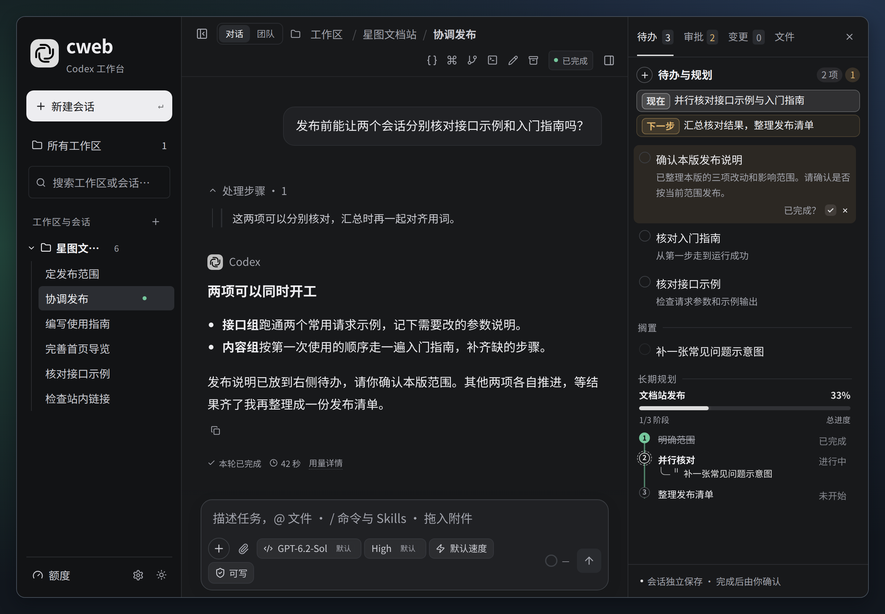
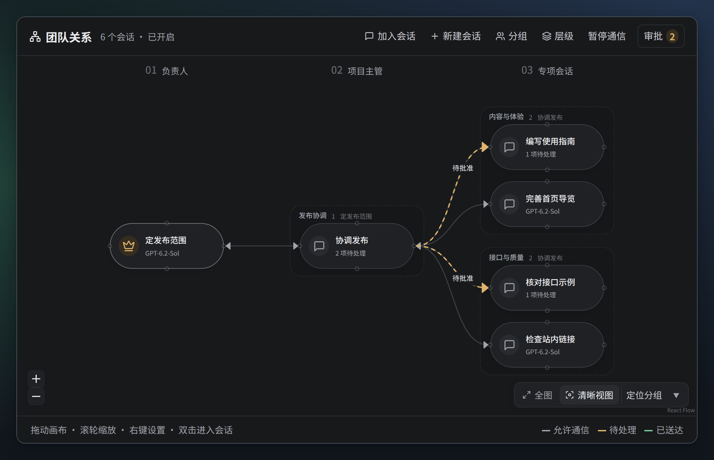
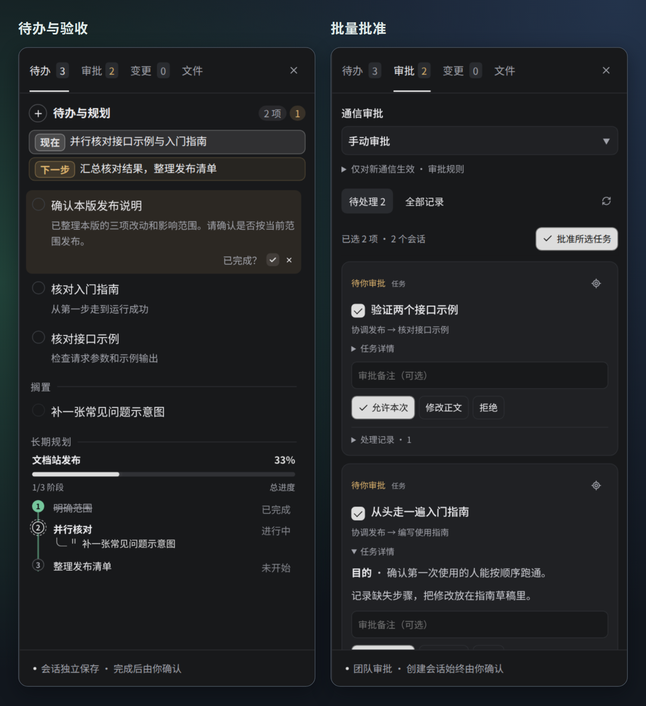

<p align="center">
  
</p>

<h1 align="center">cweb</h1>

<p align="center"><strong>Use your local Codex CLI in the browser. Split a project across sessions and track the work in one place.</strong></p>

<p align="center">
  <a href="https://github.com/lp86ndlb/codex-web/releases/latest"></a>
</p>

<p align="center">
  <a href="docs/releases/v0.5.0.md">What’s new in 0.5 Signal</a> ·
  <a href="#quick-start">Quick start</a> ·
  <a href="#work-across-sessions">Team mode</a> ·
  <a href="#tasks-and-review">Tasks and review</a> ·
  <a href="README.md">简体中文</a>
</p>

<p align="center">
  <a href="#quick-start"></a>
  <a href="package.json"></a>
  <a href="LICENSE"></a>
</p>

[](docs/assets/readme/workbench.webp?raw=1)

<sub>All screenshots show the actual cweb interface with a fictional docs project. Click a screenshot to see it at full size. The current interface uses Chinese labels, included below alongside their English meanings.</sub>

## Quick start

On Ubuntu, you'll need **Git**, **Node.js 24.9 or newer** with npm, and the **Codex CLI**. Run `codex` in your terminal first to make sure it works. [Codex CLI installation](https://github.com/openai/codex#quickstart)

```bash
git clone https://github.com/lp86ndlb/codex-web.git
cd codex-web
npm run setup
./cweb
```

You can also download the source ZIP from the release page, extract it, and run the last two commands in that directory. If the page doesn't open automatically, visit [http://127.0.0.1:4780](http://127.0.0.1:4780). In the sidebar, open **All Workspaces** (「所有工作区」), then choose **Add Workspace** (「添加工作区」) and select your project folder.

| Command | What it does |
| --- | --- |
| `./cweb status` | Shows the server address and whether a task is running. |
| `./cweb doctor` | Checks the local environment, build, and server. |
| `./cweb restart --no-browser` | Restarts the server once its tasks are idle. |

cweb runs in the background. To update a Git installation, pull the new code, run `npm run setup`, and restart when tasks are idle. [Ubuntu deployment and troubleshooting (Chinese)](docs/ubuntu-deployment.md)

## Work across sessions

If you are getting a documentation site ready to ship, one session can check API examples while another walks through the getting-started guide. A coordinator can follow both and pull their findings together. Every member stays available as an ordinary chat.

[](docs/assets/readme/team.webp?raw=1)

1. Right-click a workspace and enable **Team Mode** (「团队模式」).
2. Open the graph and use **Add Session** (「加入会话」) to give existing sessions roles and groups. The arrows show who can send work to whom. Double-click a node to open its chat.
3. Use **Approvals** (「审批」) to review incoming requests. Select independent tasks and click **Approve Selected Tasks** (「批准所选任务」) to release them together.

Different recipient sessions can work in parallel. Multiple tasks for one session are queued. Each workspace has its own approval policy. [Team mode guide (Chinese)](docs/team-mode.md)

## Tasks and review

Each chat has its own **Tasks** (「待办」) tab. It shows what is being worked on, what comes next, and which items need your confirmation. The tab count includes both active items and items waiting for review.

[](docs/assets/readme/task-panels.webp?raw=1)

Team approvals decide whether a task may be sent. The task list is where you review the work after it is submitted. You can read the handoff, accept it or send it back, reorder items, and set aside work you are not ready to pick up.

## How it connects to Codex

cweb is a community project that connects to the local `codex app-server`. It uses your Codex configuration and session history. You can reopen a native session in the terminal with `codex resume`. The browser can also show Git changes, preview local files, and accept attachments.

The server listens on a loopback address by default. Your files and session data stay on your machine. Model requests can still go to your configured provider. [Native session history (Chinese)](docs/native-history.md) · [Security and data boundaries](SECURITY.md)

## Contributing

- [Documentation index (Chinese)](docs/README.md)
- [Contribution guide](CONTRIBUTING.md)
- [Report an issue](https://github.com/lp86ndlb/codex-web/issues)

cweb is available under the [MIT license](LICENSE). It uses [OpenAI Codex](https://github.com/openai/codex) for sessions and tool execution. Some interface patterns are adapted from [DeepSeek Harness](https://github.com/deepseek-ai/deepseek-harness). [Third-party components](bridge/client/dsh/README.md) · [Task note adapter](bridge/plugins/todo-note/README.md) · [GenUI adapter](bridge/plugins/genui/README.md)
