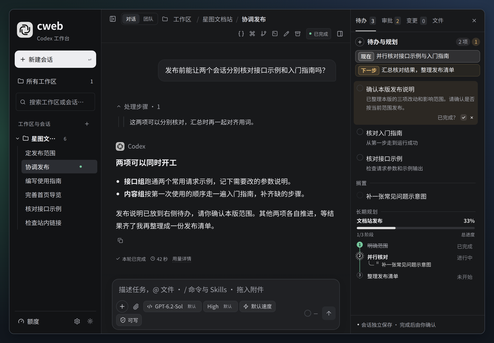
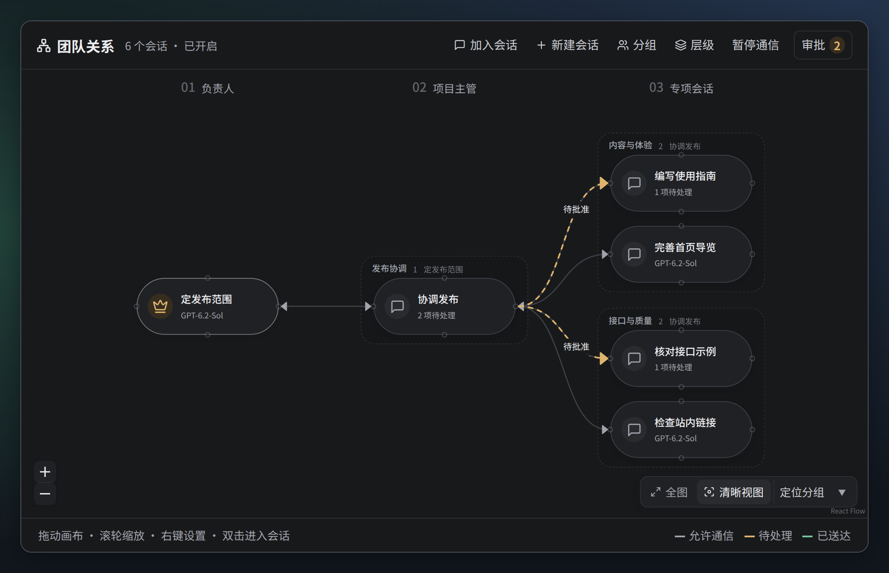
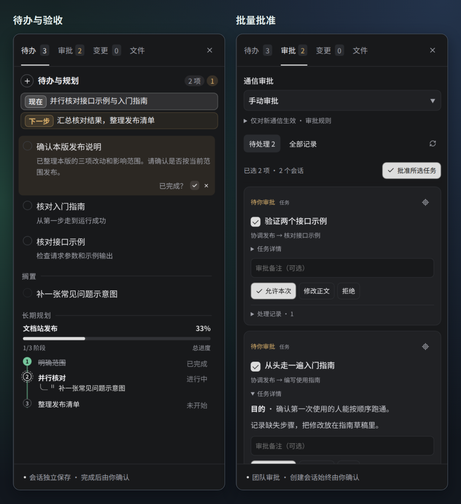

<p align="center">
  
</p>

<h1 align="center">cweb</h1>

<p align="center"><strong>在浏览器里使用本机 Codex，给不同会话分工，在待办里跟进结果。</strong></p>

<p align="center">
  <a href="docs/ubuntu-deployment.md"></a>
  <a href="package.json"></a>
  <a href="LICENSE"></a>
</p>

<p align="center">
  <a href="#团队分工">团队分工</a> ·
  <a href="#待办与验收">待办与验收</a> ·
  <a href="#快速开始">快速开始</a> ·
  <a href="docs/README.md">使用文档</a>
</p>



<sub>截图来自 cweb 本身。演示项目「星图文档站」及其中的会话均为虚构。</sub>

## 团队分工

准备给文档站发新版时，可以让主管把「核对接口示例」和「试走入门指南」交给两个会话。两个专项各自推进，主管收齐结果后再整理发布清单。每个成员都保留原来的会话，你随时可以点进去查看过程或直接交代工作。



- **让关系图说明谁负责什么。** 拖动画布查看各组，沿箭头看哪些会话能通信，双击节点回到原对话。
- **把能同时开工的事一次派出去。** 在右侧「审批」勾选独立任务并批准，不同接收会话可以并行。同一个会话收到多条任务时，按队列处理。
- **保留你需要的决定权。** 每个工作区单独开启团队模式，可选手动审批、按规则审批或 AI 风险审核。需要的上级审核仍会保留。

第一次使用团队模式时，右键工作区，打开「团队模式」，再把已有会话加入关系图。 [团队模式指南](docs/team-mode.md)

## 待办与验收

每个会话都有自己的待办。Codex 可以记录手头工作、接下来做什么，以及交付结果。隔天回来，先看右侧的「现在」和「下一步」，就能接着做。



| 我想做什么 | 在哪里处理 |
| --- | --- |
| 看还有多少事没完成 | 「待办」标签旁的数字包含进行中和待确认事项。 |
| 看工作做到哪一步 | 待办里有当前重点、下一步和阶段进度，可拖动任务排序或先搁置。 |
| 决定交付能不能通过 | Codex 提交确认后，打开该条任务看交付说明，再通过或退回。 |
| 决定是否让成员开工 | 在「审批」里核对任务内容和接收方，可一次批准多项。 |

待办默认放在右侧栏，也可以在设置里改回悬浮便签。 [待办与其他操作](docs/usage.md)

## 快速开始

准备好 Git、Node.js **24.9+**（含 npm），以及在终端里已能正常使用的 Codex CLI。

```bash
git clone https://github.com/lp86ndlb/codex-web.git
cd codex-web
npm run setup
./cweb
```

打开 [http://127.0.0.1:4780](http://127.0.0.1:4780)，添加项目所在的文件夹。启动器会在后台运行，并尝试打开浏览器。可用 `./cweb status` 看服务状态，或用 `./cweb doctor` 检查环境。 [Ubuntu 部署、升级与故障排查](docs/ubuntu-deployment.md)

## 它怎样接入 Codex

cweb 是独立的社区项目。网页通过本机 `codex app-server` 运行会话，默认沿用终端里的 `CODEX_HOME`。你可以在网页查看同一份原生历史，也可以用 `codex resume` 回终端继续。

cweb 适合用浏览器管理**这台电脑**上的项目和 CLI 会话。OpenAI 的 Codex Cloud 提供官方托管的云端任务入口。模型访问、用量和权限仍取决于你配置的 CLI、账户和提供商。 [Codex Cloud](https://learn.chatgpt.com/docs/cloud) · [本地原生历史](docs/native-history.md)

网页里还可查看 Git 变更、预览本地文件、拖入图片，以及使用 `/plan`、`/goal` 和模型提供的速度档位。项目数据保存在本机，模型请求可能访问所配置的服务。 [使用指南](docs/usage.md) · [数据与安全边界](SECURITY.md)

## 继续了解

- [文档目录](docs/README.md) · 安装、迁移、使用和架构
- [贡献指南](CONTRIBUTING.md) · 开发环境与验证方法
- [问题反馈](https://github.com/lp86ndlb/codex-web/issues) · 使用问题和功能建议

项目采用 [MIT 许可证](LICENSE)。会话与工具执行基于 [OpenAI Codex](https://github.com/openai/codex)，部分交互参考 [DeepSeek Harness](https://github.com/deepseek-ai/deepseek-harness)。组件来源及原有许可见 [DSH 组件](bridge/client/dsh/README.md)、[待办适配](bridge/plugins/todo-note/README.md) 和 [GenUI 适配](bridge/plugins/genui/README.md)。
