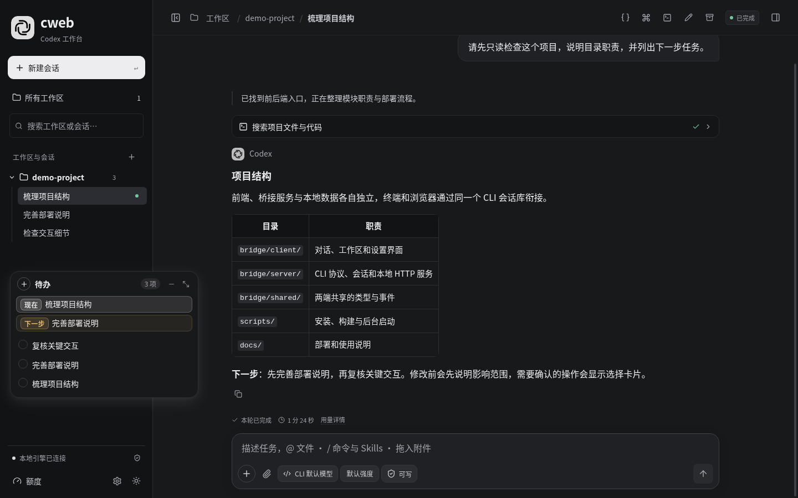

<p align="center">
  
</p>

<h1 align="center">cweb</h1>

<p align="center"><strong>给本机 Codex CLI，一个更顺手的网页工作台。</strong></p>

<p align="center">
  <a href="docs/ubuntu-deployment.md"></a>
  <a href="package.json">=24.9" /></a>
  <a href="bridge/tsconfig.json"></a>
  <a href="https://github.com/topics/codex-cli"></a>
  <a href="LICENSE"></a>
</p>

<p align="center">
  <a href="#快速开始">快速开始</a> ·
  <a href="#与官方-codex-web-的区别">产品定位</a> ·
  <a href="docs/README.md">文档</a> ·
  <a href="CONTRIBUTING.md">参与贡献</a> ·
  <a href="https://github.com/lp86ndlb/codex-web/issues">反馈问题</a>
</p>

cweb 是面向单用户本机开发的独立 Web 客户端。它通过 **`codex app-server`** 驱动真实的 CLI 会话、工具、沙箱和审批，在浏览器中管理工作区、查看执行过程、回答问题和跟踪待办。

**这是社区项目，与 OpenAI、DeepSeek 无隶属关系。** 使用前需要自行安装并配置 Codex CLI；模型访问、计费与可用能力由所用的 CLI、账户和模型服务决定。



<sub>实际 cweb 界面，使用模拟 CLI 与演示数据；不含真实项目、账户或会话内容。</sub>

## 为什么使用 cweb

- **沿用终端工作流。** 默认使用同一个 `CODEX_HOME`，在网页和终端之间查找、恢复同一份原生会话，不另造一套对话库。
- **围绕本机项目组织工作。** 图形化打开目录、按工作区归类会话、手动排序、引用本地文件，并查看 Git 变更。
- **让需要你介入的时刻更清楚。** 问题与审批显示在输入框上方；完成和待回复状态提供提示。每会话待办支持阶段、搁置、用户确认和驳回。
- **保留可读的执行过程。** 展示步骤说明、实时用时和可获得的用量；支持 Markdown、LaTeX、附件，以及适配的 GenUI 交互内容。

界面以灰阶、清晰字号和可关闭的动态效果为基础。具体操作、快捷键与兼容边界见[使用指南](docs/usage.md)。

## 与官方 Codex Web 的区别

cweb 的核心定位是 **本机 CLI 的浏览器入口**。下表主要以官方文档中的 **Codex Cloud 网页云任务**为比较对象；官方产品也提供桌面和远程连接等工作方式，不能把“官方网页版”一概理解为无法使用本机资源。

| 维度 | cweb | 官方 Codex Cloud 网页任务 |
| --- | --- | --- |
| 执行位置 | 本机 `codex app-server`，使用本机项目与工具 | 云端独立任务工作区 |
| 环境准备 | 沿用所启动 CLI 的账户、配置和本机工具 | 在云环境中准备仓库、依赖、网络与凭据 |
| 会话入口 | 围绕本机 CLI 原生历史和工作区组织 | 从官方 Web、移动端或应用继续云任务 |
| 运行与维护 | 自行部署、更新；运行任务的电脑须保持可用 | 由官方托管云执行，任务可在本机休眠后继续 |
| 更适合 | 已在终端使用 Codex，希望获得本机网页交互 | 希望将任务交给云环境执行并跨设备跟进 |

官方能力依据：[Codex Cloud](https://learn.chatgpt.com/docs/cloud)、[Remote connections](https://learn.chatgpt.com/docs/remote-connections)、[App Server](https://learn.chatgpt.com/docs/app-server)。本项目的取舍在于部署位置和交互方式，不代表模型能力、速度或费用优于官方产品。

## 快速开始

准备好 **Node.js 24.9+、npm、Git 和已能正常使用的 Codex CLI**，然后运行：

```bash
git clone https://github.com/lp86ndlb/codex-web.git
cd codex-web
npm run setup
./cweb
```

默认地址为 **http://127.0.0.1:4780**。启动器在后台运行并尝试打开浏览器，随后释放终端；工作区在网页中添加。

```bash
./cweb status                 # 查看地址与状态
./cweb start --no-browser     # 手动打开浏览器
./cweb start --port 4781      # 使用其他端口
./cweb logs                   # 查看日志
./cweb stop                   # 正常停止
```

从任意终端使用 `cweb`、环境变量、自定义 CLI 和浏览器、升级与排错，以及可直接交给 Codex 的部署提示，见 [Ubuntu 部署指南](docs/ubuntu-deployment.md)。

## 能力与边界

| 已提供 | 说明 |
| --- | --- |
| 多工作区与会话管理 | 搜索、归档、恢复、手动排序，与终端共享原生历史 |
| 输入与交互 | 图片/文件拖入和粘贴、`@` 文件引用、`/` 命令与 Skills 索引、插话和排队 |
| 模型与权限 | 配置本轮/下一轮模型与强度，使用 CLI 的文件权限和审批策略 |
| 规划与待办 | 原生 `/plan`、`/goal`，适配的待办便签和人工验收流程 |
| 内容展示 | Markdown、LaTeX、差异、结构化问答与 GenUI，按需展开执行详情 |
| 连接与恢复 | 分层状态、原生网络诊断、脱敏报告、持久草稿与提交结果核对 |
| 原生会话操作 | 指定历史位置分支、代码审查、MCP 表单与 URL 确认 |
| 本地后台启动 | 服务复用、端口检查、浏览器打开、状态和日志命令 |

**当前边界：**主要验证环境为 Ubuntu/Linux、Codex CLI `0.167.0` 和 Edge `150`；其他系统与 CLI 版本需自行验证。cweb 不是完整终端模拟器，也不提供通用 DSH 插件宿主、网页内登录或多用户托管。部分功能依赖 CLI 实验接口；历史编辑要求原生记录支持回退，且不会撤销项目文件修改。

新增能力按 Codex CLI `0.169.0` 的本机协议验证，并实测其网络诊断；详细范围、浏览器截图和后续事项见[升级验收记录](docs/releases/2026-11-14-reliability.md)。队列目前仍是服务进程内状态，分支话题共享项目文件。

“本机运行”不等于“离线模型”：模型请求、地图和外部媒体仍可能连接所配置的服务。运行数据保存在本机，不随 Git 仓库分发；详情见[安全与数据边界](SECURITY.md)。

## 项目结构

```text
codex-web/
├── cweb                       # 项目内启动入口
├── scripts/                   # 安装、构建与后台服务控制
├── bridge/
│   ├── client/                # React 界面与交互
│   ├── server/                # HTTP / SSE、CLI 协议与持久化
│   ├── shared/                # 前后端共享类型与纯逻辑
│   ├── plugins/               # 待办与 GenUI 的专用适配
│   ├── public/                # 随源码分发的静态资源
│   └── tests/                 # 协议、集成与浏览器检查
├── docs/                      # 部署、使用、架构与演示资源
└── .github/                   # 问题模板与仓库主题建议
```

代码入口、请求路径及数据目录见[架构与目录](docs/architecture.md)。依赖、构建、缓存、附件和个人会话由 `.gitignore` 排除；`bridge/package-lock.json` 与插件必需的源码保留在仓库。

## 文档与贡献

- [Ubuntu 部署与迁移](docs/ubuntu-deployment.md)：安装、启动、共享会话及常见问题。
- [使用指南](docs/usage.md)：输入、快捷键、模型权限、待办和内容展示。
- [架构与目录](docs/architecture.md)：模块职责、协议和持久化边界。
- [贡献指南](CONTRIBUTING.md)：开发环境、验证与变更约定。
- [维护与 GitHub 主题](docs/maintaining.md)：README 参考、Topics 和发布前检查。

## 致谢与许可

交互参考 [DeepSeek Harness](https://github.com/deepseek-ai/deepseek-harness)，会话与工具执行基于 [OpenAI Codex](https://github.com/openai/codex)。待办与 GenUI 使用专用适配，不要求安装或修改原 DSH 程序。

本项目采用 [MIT 许可证](LICENSE)。第三方来源、版本与原有许可继续保留在 [DSH 组件说明](bridge/client/dsh/README.md)、[待办适配说明](bridge/plugins/todo-note/README.md) 和 [GenUI 适配说明](bridge/plugins/genui/README.md) 中；对应组件仍须遵守各自的版权与许可声明。
