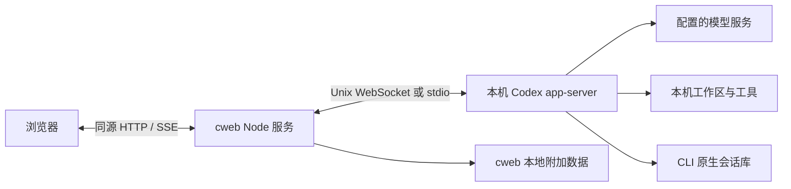

# 架构与项目结构

[项目首页](../README.md) · [Ubuntu 部署](ubuntu-deployment.md) · [使用指南](usage.md) · [贡献指南](../CONTRIBUTING.md)

cweb 提供本机网页界面与桥接服务。Codex CLI 负责模型请求、工具执行、沙箱、审批及原生会话；cweb 负责浏览器交互、协议投影和网页附加数据。

## 请求路径



优先使用检测到的原生常驻服务；没有可用服务时，cweb 管理自己的 stdio 子进程。关闭连接到外部引擎的 cweb 不会停止该引擎。CLI 模型请求仍会发往配置的模型服务，本地网页不等于离线推理。

HTTP 写请求校验同源信息与本地控制令牌。浏览器接收展示所需的会话投影，不接收 CLI 的 API key 或 OAuth token，也不提供任意 RPC 转发接口。文件浏览按工作区校验真实路径；对 CLI 授予的文件、网络权限仍由会话权限与审批策略决定。

## 目录职责

```text
codex-web/
├── README.md                    项目入口、定位和快速开始
├── CONTRIBUTING.md              开发与贡献约定
├── SECURITY.md                  权限、数据边界与隐私反馈
├── .github/                     Issue 模板与仓库 Topics 建议
├── docs/
│   ├── README.md                 文档导航
│   ├── ubuntu-deployment.md      安装、迁移、排错及 Codex 辅助部署
│   ├── usage.md                  操作、快捷键、插件及功能边界
│   ├── architecture.md           架构、目录和数据归属
│   ├── maintaining.md            仓库展示与维护约定
│   └── assets/                   标志与演示数据截图
├── cweb                         仓库内启动入口
├── scripts/                     后台启动器、依赖构建与可选入口安装器
└── bridge/
    ├── client/                  React 界面、渲染、状态及浏览器交互
    ├── server/                  HTTP/SSE、CLI RPC、工作区与本地存储
    ├── shared/                  前后端类型与纯逻辑
    ├── public/                  随仓库分发的静态资源
    ├── plugins/
    │   ├── todo-note/           便签模型、界面与会话级 MCP 适配
    │   └── genui/               GenUI 渲染器、Skill 与来源说明
    ├── tests/                   单元、协议、HTTP、启动器及浏览器验证
    ├── package.json             桥接服务与前端的依赖和任务
    └── package-lock.json        可复现安装的依赖锁定
```

`bridge/dist/`、`bridge/node_modules/`、`bridge/.data/`、`.cache/` 和测试输出是生成或个人数据目录，不进入 Git。根目录 `upstream/` 仅用于可选的交互参考，不参与运行；`bridge/plugins/todo-note/upstream/` 是内置插件必需源码，随 Git 保存。

## 主要实现入口

| 范围 | 入口与职责 |
| --- | --- |
| 后台生命周期 | [`scripts/cweb.mjs`](../scripts/cweb.mjs)：启动复用、状态、日志与停止 |
| 服务初始化 | [`bridge/server/main.ts`](../bridge/server/main.ts)：运行目录、原生引擎和回环监听 |
| HTTP 与事件 | [`bridge/server/http.ts`](../bridge/server/http.ts)：接口、同源校验和 SSE |
| CLI 协议 | [`rpc.ts`](../bridge/server/rpc.ts)、[`bridge.ts`](../bridge/server/bridge.ts)：连接、请求和会话协调 |
| 展示投影 | [`projection.ts`](../bridge/server/projection.ts)：将原生事件和历史映射为界面数据 |
| 文件边界 | [`catalog.ts`](../bridge/server/catalog.ts)、[`workspace.ts`](../bridge/server/workspace.ts)：工作区和真实路径校验 |
| 页面组合 | [`bridge/client/App.tsx`](../bridge/client/App.tsx)：会话、设置、输入和面板协调 |
| 长会话与阅读 | [`Transcript.tsx`](../bridge/client/Transcript.tsx)、[`useConversationScroll.ts`](../bridge/client/useConversationScroll.ts) |
| 连接诊断 | [`diagnostics.ts`](../bridge/server/diagnostics.ts)、[`ConnectionPanel.tsx`](../bridge/client/ConnectionPanel.tsx)：有界事件记录、独立诊断进程与分层状态 |
| 草稿与提交回执 | [`composer-cache.ts`](../bridge/client/composer-cache.ts)、[`submissions.ts`](../bridge/server/submissions.ts)：浏览器草稿与服务端提交去重 |
| 原生交互 | [`elicitation.ts`](../bridge/shared/elicitation.ts)、[`ElicitationCard.tsx`](../bridge/client/ElicitationCard.tsx)、[`NativeActions.tsx`](../bridge/client/NativeActions.tsx)：MCP 表单、分支与审查 |
| 共同协议 | [`bridge/shared/types.ts`](../bridge/shared/types.ts)：界面与服务的数据类型 |

## 数据归属

| 数据 | 保存位置 | Git 中是否包含 |
| --- | --- | --- |
| 应用源码、依赖锁文件、内置插件来源和许可证 | 本仓库 | 包含 |
| 默认模式的原生会话、归档、CLI 配置与认证 | 启动环境的 `CODEX_HOME`，默认 `~/.codex` | 不包含 |
| 网页工作区名称、选项、附件、便签、GenUI 面板和附加统计 | `bridge/.data/`，可由 `CWEB_DATA_DIR` 更改 | 不包含 |
| 侧栏顺序、开合与部分交互偏好 | 当前浏览器本地存储 | 不包含 |
| 未提交的异步问答草稿 | 当前标签页的会话存储 | 不包含 |
| 普通输入草稿、附件引用、编辑状态与待核对消息 | 当前浏览器本地存储，按话题保存 | 不包含 |
| 提交 ID、输入指纹与结果状态 | `bridge/.data/submission-receipts.json`；不存消息正文 | 不包含 |
| 独立模式的 CLI 数据 | cweb 数据目录下的 `codex-home/` | 不包含 |

原生历史仍以 CLI 为准。支持分页存储的会话通过 CLI 历史接口读取；界面采用最近消息窗口，较早消息按需显示。网页统计仅补充观测数据，不复制一套模型会话历史作为执行依据。

提交回执采用原子 JSON 存储，最多保留 2,000 条；优先淘汰已明确接受或拒绝的旧回执，未核对记录不自动重放。回执保留期内，相同 ID 和内容不会再次启动任务；新 ID、用户恢复草稿后的重新发送、进程内队列不构成跨所有操作的永久去重保证。连接事件最多保留 100 条，仅在内存记录类别和时间，不保存错误中的用户正文。

插件只实现各自需要的宿主适配，不是通用 DSH 插件运行时。便签数据按会话保存，完成操作需要用户验收；GenUI 的纯本地交互不请求模型，需要 agent 处理的操作回到对应会话。来源与授权见 [便签说明](../bridge/plugins/todo-note/README.md)、[GenUI 说明](../bridge/plugins/genui/README.md) 和 [界面组件说明](../bridge/client/dsh/README.md)。

## 结构调整原则

按 `client / server / shared / plugins / tests` 保留现有运行边界。说明性内容集中到 `docs/`，贡献流程放在根目录，避免在 README 堆积实现细节。重排运行时代码时应同时更新导入、启动脚本、插件路径、打包配置和测试；不要只移动文件来获得更短的目录树。
