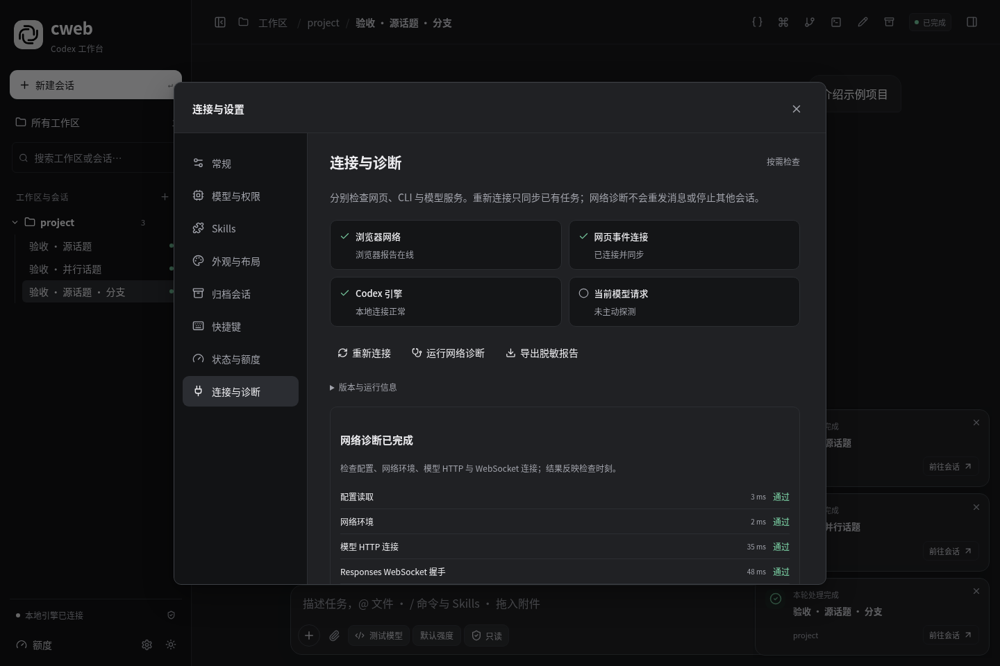
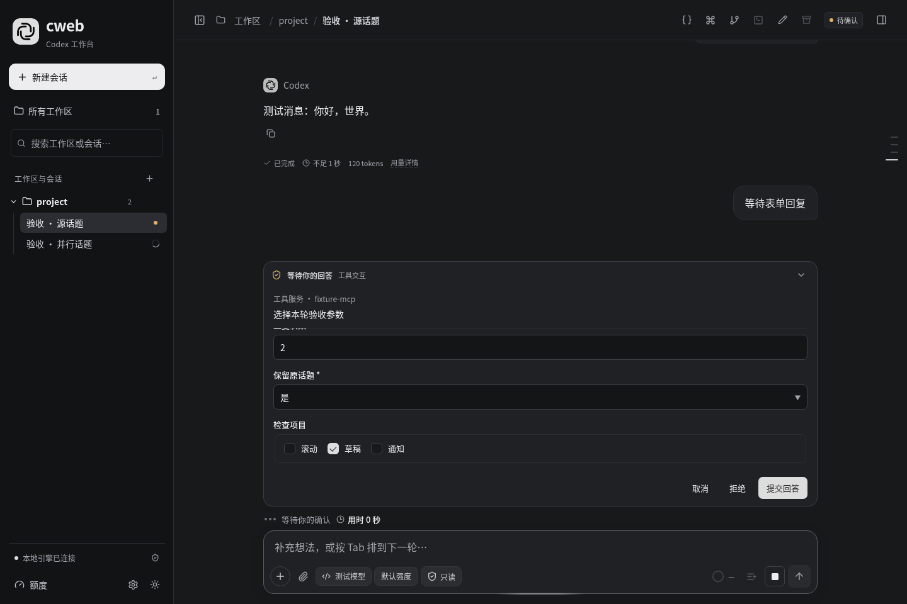

# 连接可靠性与原生能力升级

[使用指南](../usage.md) · [能力调研与后续清单](../research/2026-11-14-agent-ui-survey.md)

本批先解决断线后无法判断状态、草稿丢失、回执不明时容易重复发送的问题，并接入原生分支、原生代码审查和 MCP 表单。继续复用现有设置、输入框上方交互区、消息组件和样式；没有新增运行依赖或替换 Agent 引擎。

这是调研方案的首批落地，包含第 1 批核心可靠性和第 2 批部分常用能力，不表示 120 项调研方向已经全部实现。

## 已实现

| 能力 | 入口与行为 |
| --- | --- |
| 分层连接状态 | 侧栏底部连接状态或 `/doctor`；区分浏览器、网页事件连接、CLI 和模型请求 |
| 原生网络诊断 | 按需调用 `codex doctor --json --network-only`，分项显示配置、网络、HTTP 与 WebSocket 检查；可取消、导出脱敏结果 |
| 连接恢复 | 保留已显示正文、阅读位置与草稿，采用退避重连并同步原任务；不自动重发 POST |
| 版本与事件 | 区分网页、桥接、安装的 CLI 与运行端标识；最多保留 100 条分类事件 |
| 持久草稿 | 按话题保存文本、已上传附件引用、Skills、文件引用和历史编辑状态；仅写入发生变化的草稿 |
| 提交结果核对 | 消息 ID、原子回执和输入指纹；刷新后先核对结果，未知状态不直接重放任务 |
| MCP 交互 | 输入框上方显示有类型的表单、单选、多选及 URL 确认；恢复期间提前到达的请求仍保留 |
| 原生分支 | `/fork`、顶部会话操作或消息旁按钮；保留来源，选择历史边界，避免自动恢复旧 Goal |
| 原生审查 | `/review`；未提交改动、基础分支、指定提交或自定义范围，结果留在当前话题 |
| 手机与现有布局 | 诊断状态适配窄屏；版本详情按需展开；横向设置分类定位当前项；长表单题目保持可见 |

MCP 不支持的复杂 schema 和设备验证会说明限制，不能用普通文字输入假装实现全部原生交互。分支共享工作区文件，不是 Git worktree。网页重连不能替代远端服务修复；原生网络诊断不会改全局 Provider、模型或认证配置。

## 截图

下图来自真实 Edge 浏览器中的隔离测试实例，使用虚构话题与模拟模型服务。未复制个人会话，也没有用真实模型执行测试任务；诊断数据中的时长是测试数据。





手机截图：[连接与诊断，390 × 844](../assets/reliability/diagnostics-mobile.png)。

## 验证范围

- TypeScript 类型检查和生产构建。
- 135 项自动测试，包含 11 项新增可靠性、表单、原生操作和失败入口测试。
- 19 套 Edge 浏览器场景通过，覆盖草稿/附件刷新、独立话题、断网重连、回执丢失、并行任务、MCP 回答、分支、审查、诊断导出和手机布局。
- 回归既有消息编辑、目录和设置、滚动、规划/目标、输入控件、动画、通知、侧栏排序、问答、实时用时、恢复、上下文、文件链接、步骤收起、长历史窗口、回溯条及本地图片。
- 在本机真实 Codex 0.169.0 上运行一次只读网络诊断；检查时配置、网络环境、模型 HTTP 和 WebSocket 握手均通过。此结果不保证之后的模型请求成功。

浏览器故障注入将消息 HTTP 响应延迟 900 ms 时，记录到消息气泡约 93 ms 出现。这是该测试机的一次界面响应样本，测量包含自动化操作开销，不是模型首字时间或跨产品性能排名。测试代码为 [`reliability.browser.mjs`](../../bridge/tests/reliability.browser.mjs)。

长历史回归使用 3,520 条原生记录、9 次连续翻页；历史窗口最多 2,035 个 DOM 节点，阅读锚点最大偏移约 0.44 px。该指标验证既有窗口与按需展开机制未退化，不代表后端历史读取已完成分页优化。

原生分支、审查与 MCP 交互使用本机 schema 和协议 fixture 验证，未把所有模型、账户和 CLI 版本都视为兼容。测试没有中断真实用户任务。

## 备份、数据与回退

- 调研前代码备份：`backup/2026-11-14-before-capability-upgrade`，指向 `bac1f56`。
- 本轮实施前备份：`backup/2026-11-14-before-reliability-implementation`，指向 `c27819c`。
- 两个标签均已通过 SSH 推送；本机另有经验证的 Git bundle。备份不包含认证、会话、附件和运行数据。
- 本批不迁移原生会话数据库。新增回执保存到 cweb 本地数据目录，草稿保存在当前浏览器；不会加入公共 Git 仓库。
- 回执最多 2,000 条，旧的已知终态记录会被淘汰，因此不能宣称永久、跨所有入口的执行去重。

需要对照改动前版本时可使用独立 worktree：

```bash
git worktree add --detach ../cweb-before-reliability backup/2026-11-14-before-reliability-implementation
```

启用后端更新使用启动器的正常重启，并保留它对执行中任务的保护；前端资源发布保留旧资源，避免已打开页面在更新期间缺少文件。

## 下一批保留事项

后续按实际使用和失败记录调整顺序，不在本批增加另一套运行时：

1. 消息队列持久化与重启后的结果核对；当前队列仍是进程内状态。
2. 端到端历史分页和负载限制；现有界面组件数量受限，后端打开话题仍可能读取完整历史。
3. 终端与后台进程、Git/worktree、配置来源、完整 MCP/插件管理。
4. 独立设计认证与跨设备访问；PWA、语音、预览批注按需求接入。

完整候选范围仍以 [能力调研](../research/2026-11-14-agent-ui-survey.md) 为准。
