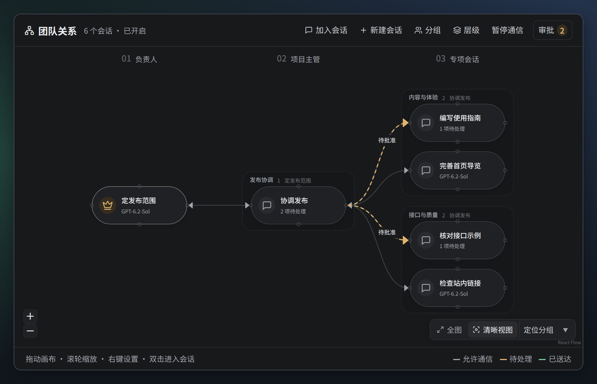

# cweb 0.4 · Relay

现在可以把同一个项目的几个 Codex 会话连成团队。主管一次派出几项独立工作，你批准后，各个会话可以同时开工。交付说明会留在待办里，方便你集中验收。

[下载 v0.4.0 源码包](https://github.com/lp86ndlb/codex-web/releases/download/v0.4.0/cweb-v0.4.0.zip) · [English setup and usage](../../README.en.md)

实际 cweb 界面，使用虚构的文档站项目演示。

## 在关系图里分工

把已有会话加入工作区的团队，给每个会话安排角色。沿着箭头就能看清哪些会话可以派任务或回传结果，双击节点即可回到原对话。遇到两项能同时做的工作，可以在侧栏一起批准。同一个接收会话仍按队列处理。

## 在待办里验收

回到某个会话，右栏会显示手头工作、下一步和待确认事项。提交验收时，待办会保留交付说明，你可以确认结果，也可以退回补做。

## 日常使用

- 支持 Fast 的模型可以在输入框选择响应速度，从下一轮生效。
- 上一条消息有回执但未进入对话记录时，本轮结束后可以继续发送，也可以恢复原文。

## 安装与更新

需要 Node.js 24.9+ 和可以在终端正常运行的 Codex CLI。解压源码包后，在目录里运行 `npm run setup` 和 `./cweb`。已有安装可按部署指南更新，在任务空闲时重启。运行数据和登录信息仍保存在本机。

[团队模式指南](../team-mode.md) · [Ubuntu 部署](../ubuntu-deployment.md) · [English guide](../../README.en.md)
