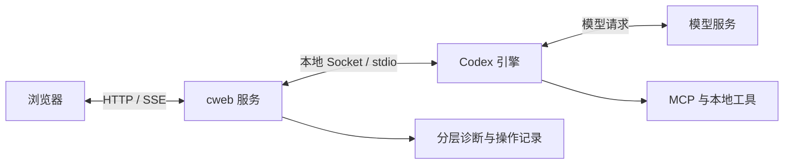

# cweb 能力扩展调研与升级清单

调研日期：2026-11-14。代码基线：`bac1f56`；本机已安装 Codex CLI：`0.169.0`。

本轮交付是调研和方案，不代表下面的待建设功能已经上线。建议保留 cweb 的本机 Codex 桥接定位，先补齐连接诊断、恢复和数据可靠性，再扩展原生会话、审查、终端、插件与配置能力。现有工作区侧栏、会话正文、输入框、右侧面板及灰阶视觉可以继续沿用。

本清单覆盖 **40 个产品或使用入口、7 项组件或协议参考、120 项功能与验收方向**。不同入口可能属于同一产品；数量不表示 40 家独立厂商。功能事实来自官方文档或项目自己的仓库，属于文档与源码调研，没有安装并逐一实测这些产品，也不据此比较模型能力或速度。

## 1. 升级前备份

| 项目 | 结果 |
| --- | --- |
| 备份前工作区 | 干净，没有未提交文件 |
| 代码提交 | `bac1f56bf50d1d5f676e4ad5a35d67f0d8eeaf78` |
| Git 备份标签 | `backup/2026-11-14-before-capability-upgrade` |
| 远端备份 | 已通过 SSH 推送，并通过远端标签解析核对到上述提交 |
| 本地完整 Git bundle | `.cache/git-backups/cweb-2026-11-14-before-capability-upgrade.bundle`，已通过 `git bundle verify` |
| 备份范围 | Git 跟踪的源码、文档和提交历史；不包含被忽略的认证、会话、附件、数据库和运行缓存 |

需要对照旧版时，可在另一个目录签出备份，避免覆盖当前工作：

```bash
git worktree add --detach ../cweb-before-upgrade backup/2026-11-14-before-capability-upgrade
```

这份代码备份不能替代后续数据库迁移前的本地数据备份。个人会话和认证应单独备份到受控位置，不上传公共 Git 仓库。

## 2. 主要结论

1. **网络恢复是最值得先做的升级。** 目前有重新连接、原生进度和一次受限自动重试，但用户仍缺少判断故障层级、查看诊断、选择恢复路径的完整入口。
2. **大部分增量不需要重新做一个 Agent。** 应继续使用 Codex app-server 的会话和工具执行机制；cweb 负责呈现、操作入口、状态协调和本地可靠性。
3. **必须补上实际缺失的能力。** 包括 MCP 交互、原生分支、网页内审查、终端与进程控制、配置来源、插件管理、持久草稿和持久队列。
4. **“功能尽可能全”不等于把全部 RPC 原样公开。** 账户验证、令牌回调、计费操作、实验性远控、底层进程管理等，需要专门适配或不进入普通界面。
5. **先复用组件，再引入小范围依赖。** 不建议为此次升级替换整套 React 界面或引入第二套 Agent 运行时。
6. **每批开发，统一验收。** 将修改分成可回退的小批次；每个功能做必要的开发验证，批次完成后统一进行真实界面验收。

Codex 官方把 app-server 定位为富客户端的集成入口，提供认证、会话历史、审批和流式事件；这与 cweb 当前架构吻合。[官方 App Server 文档](https://learn.chatgpt.com/docs/app-server)

## 3. 产品与界面参考

表中的“可借鉴”是对 cweb 的设计建议，不表示第三方已经解决了 cweb 的具体故障。商业产品用于观察交互；公开源码项目也需要按具体版本和组件确认许可。

### 3.1 OpenAI 官方入口

| # | 产品或入口 | 已核实的参考点 | 对 cweb 的价值与边界 |
| --- | --- | --- | --- |
| 01 | [ChatGPT 网页与 Projects](https://help.openai.com/en/articles/10169521-projects-in-chatgpt) | 项目文件、项目指令、会话归组、工具入口 | 学习项目资料与聊天的组织；cweb 同目录话题不会因此自动共享完整对话记忆 |
| 02 | [ChatGPT Work](https://help.openai.com/en/articles/20001275-chatgpt-work-and-codex) | 面向多步骤任务与成品交付；与普通 Chat、Codex 分工不同 | 将任务过程和产物分开；不能把 Work 云服务视为 CLI 自动具备的能力 |
| 03 | [ChatGPT 桌面中的 Codex](https://learn.chatgpt.com/docs/features) | 项目、长任务、插件、浏览器、通知等工作入口 | 学习收敛的入口分组；实际能力需按桌面、网页、CLI 分别核实 |
| 04 | [Codex Cloud 网页任务](https://learn.chatgpt.com/docs/cloud) | 独立云工作区、持续运行、检查变更与结果、提交或 PR | 学习任务结果和审查流程；云执行、环境管理不能由本机网页界面直接替代 |
| 05 | [Codex CLI 与 IDE 入口](https://learn.chatgpt.com/docs/developer-commands) | 原生命令、会话恢复、运行控制与配置；各入口命令不完全一致 | 作为能力覆盖基准；网页菜单必须连接实际操作，不能只发送看起来像命令的文本 |

补充：官方[项目说明](https://learn.chatgpt.com/docs/projects)区分本地目录与 ChatGPT Projects；[长任务说明](https://learn.chatgpt.com/docs/long-running-work)区分 CLI/桌面 Goal 与网页 Work。官方[浏览器文档](https://learn.chatgpt.com/docs/browser)明确内置 Browser 不直接属于 Codex CLI/IDE；cweb 若需要浏览器操作，必须另接可用工具或浏览器宿主。官方[远程连接](https://learn.chatgpt.com/docs/remote-connections)也有宿主、账户和入口要求，不能因本地 schema 出现远控方法就承诺接入官方云中继。

### 3.2 商业 Agent 应用与 IDE

| # | 产品或入口 | 已核实的参考点 | 建议借鉴 |
| --- | --- | --- | --- |
| 06 | [Claude Code Desktop](https://code.claude.com/docs/en/desktop) | 并行会话、Git 隔离、终端与编辑器、差异、预览、旁支提问 | 保留主聊天，让文件、终端、预览在旁边按需展开 |
| 07 | [Claude Code Remote Control](https://code.claude.com/docs/en/remote-control) | 远端入口控制本地会话、跨设备进度同步、连接中断后恢复 | 区分“任务还在运行”和“当前浏览器没连上” |
| 08 | [Cursor Agent](https://cursor.com/docs/agent/overview) | 工具执行、浏览器、检查点、Agent 组织 | 差异审查与阶段检查点；对话回退和文件恢复要分开说明 |
| 09 | [VS Code Agent Sessions](https://code.visualstudio.com/docs/agents/concepts/sessions) | 会话、聊天分支、工作区和 worktree 的区别；并行与跨入口 | 明确会话分支不等于文件隔离；共享目录时仍可能修改同一文件 |
| 10 | [Zed Agent Panel](https://zed.dev/docs/ai/agent-panel) | 多话题、工作树、编辑消息、队列、摘要续接、外部 Agent | 当前话题操作紧凑呈现；外部 Agent 能力不足时明确显示限制 |
| 11 | [Warp](https://docs.warp.dev/terminal/blocks/) | 命令与输出组成可复制、搜索、导航的块 | 将长命令日志按执行单元组织，改善“无限终端滚动” |
| 12 | [Devin](https://docs.devin.ai/get-started/devin-intro) | 云任务、浏览器预览、测试记录、会话工具和集成 | 交付面板同时给出改动、测试与预览证据 |
| 13 | [Windsurf/Cascade 历史交互](https://docs.devin.ai/desktop/cascade) | 文档保留计划、消息排队、检查点、worktree 等设计 | 当前文档标为 legacy，且说明不再启动或打开 Cascade 会话；只作历史参考 |
| 14 | [Kiro](https://kiro.dev/docs/getting-started/first-project/) | 需求与任务规范、steering、hooks、MCP | 将“目标—实施任务—验收标准”链接起来，沿用现有 Todo/Goal |
| 15 | [Google Antigravity](https://antigravity.google/docs/browser/) | 浏览器侧面板、截图与控制台/网络检查、接管与登录交还 | 网页验收的证据呈现；浏览器后端与账户差异必须可见 |

### 3.3 与 cweb 接近的公开源码客户端和工作台

| # | 项目 | 已核实的参考点 | 对 cweb 的适配判断 |
| --- | --- | --- | --- |
| 16 | [DeepSeek Harness](https://github.com/deepseek-ai/deepseek-harness) | Web UI、插件架构；官方指南覆盖工作区、任务和审批 | 最适合保持现有组件风格；继续使用已有 DSH 适配层，避免照搬整个运行时 |
| 17 | [OpenCode](https://github.com/anomalyco/opencode) | CLI、桌面、Plan/Build、子 Agent、多 Provider | 学习能力发现与模式切换；其接口不能替换 Codex 原生协议 |
| 18 | [CodexMonitor](https://github.com/Dimillian/CodexMonitor) | app-server 客户端、上下文环、队列/插话、worktree、Git、终端和调试面板 | **原生 Codex 能力映射的重点参考**；桌面专属部分需改造成浏览器交互 |
| 19 | [Happy](https://github.com/slopus/happy) | Codex 等 CLI 包装、移动与 Web、加密设备同步 | 学习离开桌面后的跟进和待处理入口；中继与设备授权属于独立工程 |
| 20 | [CloudCLI / Claude Code UI](https://github.com/siteboon/claudecodeui) | 移动与桌面 Web、Shell、文件编辑、Git、多个 CLI | **网页操作面板的重点参考**；其 AGPL 许可不适合直接当作 MIT 组件复制 |
| 21 | [AionUi](https://github.com/iOfficeAI/AionUi/wiki/Getting-Started) | 本地 CLI 检测、多会话、文件面板与模型配置 | 学习首次连接和接入引导；逐个核对 Adapter 能力，不假设所有 CLI 功能一致 |
| 22 | [OpenChamber](https://github.com/openchamber/openchamber) | 目标、并行运行、变更导览、预览定位、设备接续、状态与计划任务 | **任务可见性和审查流程的重点参考**；它依赖 OpenCode，需重新映射到 Codex |
| 23 | [Vibe Kanban](https://github.com/BloopAI/vibe-kanban) | 看板任务、独立工作区、差异评论、预览和 PR | README 已声明 sunsetting；保留任务到审查的设计参考，不作为新核心依赖 |
| 24 | [OpenHands Agent Canvas](https://github.com/OpenHands/OpenHands) | 自托管 Agent 工作台、多后端、ACP Agent 和自动化 | 学习运行环境、任务和自动化的分层；不为本地单用户引入整套云编排 |

### 3.4 公开源码 Agent 与开发工作流

| # | 项目 | 已核实的参考点 | 建议借鉴 |
| --- | --- | --- | --- |
| 25 | [Cline](https://github.com/cline/cline) | Plan/Act、工具审批、文件差异、检查点、桌面/IDE/CLI 共用核心 | 审批时完整说明操作对象；保留原生任务状态与网页展示的分离 |
| 26 | [Kilo Code](https://github.com/Kilo-Org/kilocode) | IDE/CLI、多模型、工具和插件扩展；新功能开发分支已有迁移说明 | 模式与工具配置的组织；依赖前固定实际版本，不追默认分支漂移 |
| 27 | [goose](https://github.com/aaif-goose/goose) | 桌面/CLI/API、本地运行、MCP 扩展、诊断；已迁至 AAIF 仓库 | 配置引导、诊断报告、可复用任务配方 |
| 28 | [Aider](https://github.com/Aider-AI/aider) | Git 记录、代码地图、自动 lint/test、图片与语音输入 | 每次改动与验证结果的对应关系；不把它的自动提交策略直接设为 cweb 默认 |
| 29 | [Continue](https://github.com/continuedev/continue) | IDE/CLI 及可定制开发体验 | README 已宣布不再积极维护及最终 2.0.0；仅保留历史设计参考 |

goose 的[配方文档](https://github.com/aaif-goose/goose/blob/main/documentation/docs/guides/recipes/recipe-reference.md)可以参考任务模板的参数填写方式。这里不执行任何安装或第三方 README 中的命令。

### 3.5 网页生成与可视化开发产品

| # | 产品 | 已核实的参考点 | 建议借鉴 |
| --- | --- | --- | --- |
| 30 | [Replit Agent](https://docs.replit.com/features/agent/overview) | Agent、预览、应用测试、检查点和发布流程 | 将测试与预览作为结果入口，避免散落在工具输出中 |
| 31 | [Bolt](https://support.bolt.new/get-started/quickstart) | 对话、代码视图、预览、版本恢复 | 提供明确的版本与预览上下文；文件恢复范围必须准确解释 |
| 32 | [Lovable](https://docs.lovable.dev/introduction/welcome) | 自然语言建站、可编辑代码、Git 同步、协作和发布 | 视觉反馈与项目结果并排；托管服务能力不纳入 CLI 直接搬运范围 |
| 33 | [v0](https://v0.app/docs) | 截图输入、代码视图、Design Mode、版本、部署 | 学习产物预览与迭代入口；优先适配本地预览而不是新增托管发布平台 |

### 3.6 通用聊天、知识与自动化工作台

| # | 项目 | 已核实的参考点 | 建议借鉴 |
| --- | --- | --- | --- |
| 34 | [Open WebUI](https://github.com/open-webui/open-webui) | 自托管、本地/远端模型、桌面入口、知识与终端生态 | 学习 Provider 设置和故障引导；当前许可含品牌保留要求，不能视为任意可复制组件 |
| 35 | [LibreChat](https://www.librechat.ai/docs/features) | 分支、Artifacts、MCP、搜索、导入导出、可恢复流 | **重连与产物面板的重点参考**；其模型服务架构无需整体引入 |
| 36 | [LobeHub](https://github.com/lobehub/lobehub) | Agent、团队、工具/Skill 市场、任务与外部 Agent 接入 | 学习设置分类、资源组织和工具发现，避免把所有入口塞进输入框 |
| 37 | [Dify](https://github.com/langgenius/dify) | 工作流、RAG、Agent、模型管理和可观测性 | 学习失败节点与运行详情；不建议现在引入完整低代码编排器 |
| 38 | [AnythingLLM](https://github.com/Mintplex-Labs/anything-llm) | 工作区资料、知识、Agent、MCP、记忆与计划任务 | 将项目资料与当轮上下文分开，避免反复塞入全部资料 |
| 39 | [Cherry Studio](https://github.com/CherryHQ/cherry-studio) | 模型服务、Agent、MCP、文件库、导出、备份与外观设置 | 学习设置可发现性和本地备份体验 |
| 40 | [Jan](https://github.com/janhq/jan) | 本地模型、远端服务、OpenAI 兼容服务与 MCP | 区分本地网页可用和模型可用；离线模型只能作为另行配置的运行方式 |

LibreChat 明确把生成任务放在服务端，浏览器刷新或断线后恢复流和工具步骤。这是可借鉴的连接语义，并不能证明远端模型断流会自动恢复。[Resumable Streams](https://www.librechat.ai/docs/features/resumable_streams)

## 4. cweb 现状核对

以下结论以基线源码为准，避免把已有功能重新列成“待开发”。

| 范围 | 已有实现 | 仍存在的缺口 |
| --- | --- | --- |
| 连接 | SSE 重连、CLI 连接状态、设置里的重新连接、终态只读核对 | 故障层级混在一起；缺少可操作的诊断报告和恢复入口 |
| 模型断流 | 原生重试/压缩状态、静默提示；网页失败请求受限自动重试一次 | 无集中错误时间线；不覆盖原生终端发起的任务；无法修复远端服务本身 |
| 上下文 | 用量圆环、原生压缩菜单、按需原图、固定上下文去重 | 缺少历史变化、来源说明、压缩事件记录、摘要接续与记忆查看 |
| 草稿 | React 状态中按会话分开保存 | 页面刷新后的持久草稿尚未实现；不能把会话内切换保留当作持久保存 |
| 队列 | 网页排队、移除和失败重试 | 队列是服务进程内存状态；缺少持久化和原生跨端队列适配 |
| 会话 | 新建、恢复、归档、重命名、编辑历史与回退 | 没有完整原生 fork、分支谱系、跨历史全文搜索与导出入口 |
| 问答审批 | 命令、文件、权限审批及原生问答；输入框上方展示 | `mcpServer/elicitation/request` 当前直接 decline；不能说已支持全部交互 |
| 原生工具 | 能显示多种工具事件，内置 Todo/GenUI 适配 | 工具可用情况、MCP 登录/故障、插件生命周期没有统一设置 |
| 文件与 Git | 浏览文件、本地文件/图片预览、差异与计划面板 | 缺少编辑、原生 review、暂存/提交、分支、worktree、后台终端入口 |
| 设置 | 外观、输入、模型/强度/权限、Skills、归档、连接与额度 | 缺少配置层级与来源、登录流程、Provider 管理和版本兼容状态 |
| 长历史 | 有限浏览窗口、步骤折叠、按需展开内容 | 后端打开历史仍会 hydrate 多页完整内容；需要端到端分页和负载上限 |
| 完成反馈 | 待处理提示、会话状态与实时用时 | 缺少统一的跨会话收件箱，以及持久的错误和恢复结果记录 |

源码证据：[App.tsx](../../bridge/client/App.tsx)、[bridge.ts](../../bridge/server/bridge.ts)、[rpc.ts](../../bridge/server/rpc.ts)、[http.ts](../../bridge/server/http.ts)、[auto-recovery.ts](../../bridge/server/auto-recovery.ts)、[Inspector.tsx](../../bridge/client/Inspector.tsx)、[SettingsPanel.tsx](../../bridge/client/SettingsPanel.tsx)、[RunTimer.tsx](../../bridge/client/RunTimer.tsx)、[共享类型](../../bridge/shared/types.ts)。

### 4.1 本机协议覆盖范围

使用本机 `codex app-server generate-json-schema` 做了两次只读能力导出：

- 默认导出：**109 个客户端请求方法**。
- 加 `--experimental`：**184 个客户端请求方法**，比默认导出多 75 个。
- 这不是“184 项用户功能”，也不是“109 项已保证稳定的功能”。
- 已安装命令是 0.169.0，不等于正在运行的常驻 daemon 已自动换成同版。
- schema 存在不等于当前模型、账户、平台、策略或运行中的服务一定允许调用。
- 不能用方法数量简单计算 cweb 完成百分比：有些功能走本地 Git/文件适配，有些方法是内部基础设施。

全部方法、导出类别、当前接入状态及建议入口见 [Codex 0.169.0 协议能力对照](codex-0.169-capability-map.md)。导出过程没有启动模型任务、压缩会话、改配置或重启服务。

## 5. 网络异常应该怎样在网页里解决

建议将“连接”页升级为“连接与诊断”，侧栏底部状态可点击打开它。正常时只显示一个低干扰状态；异常时在输入框上方显示一句可理解的原因和一个主要操作，详情进入侧面板。



| 故障位置或状态 | 用户应该看到什么 | 默认动作 | 操作边界 |
| --- | --- | --- | --- |
| 浏览器离线或失去网页连接 | “网页连接已断开，服务端任务状态待核对”；保留正文和草稿 | 自动重建事件连接并补齐状态 | `navigator.onLine` 只作提示，不能据此认定模型服务断网 |
| cweb HTTP/SSE 不通 | 最后连接时间、重连次数、服务地址、最近已确认状态 | 有退避的重连；允许手动重连网页 | 重连页面不重发模型任务 |
| cweb 与 CLI 断开 | 引擎连接中断、共享或独立引擎、重新附着结果 | 先重新连接原生引擎，再读取现有轮次 | 不能为恢复一个话题杀掉共享 daemon |
| CLI 与模型服务断流 | 原生错误类别、CLI 正在重试与否、可获得的重试次数 | 等原生恢复；主动诊断按钮 | HTTP fallback 只有收到证据才显示，不能编造或强制切换 |
| 请求已明确失败 | 本轮是否已执行工具、能否安全重试、不能自动重试的原因 | 保留现有一次安全自动重试策略；提供手动下一步 | 已执行命令或结果未知时不自动重放 |
| HTTP 请求超时但提交结果未知 | “结果待核对”，保留临时消息与请求标识 | 用原生轮次和消息标识查结果 | 不把超时直接当成未发送 |
| 401/鉴权失效 | 登录状态和修复入口 | 引导原生授权；完成后核对任务 | 不自动换账号，也不把密钥暴露到浏览器 |
| 429/额度不足 | 可获得的重置时间、账户窗口、当前使用状态 | 等待、提醒或让用户选择之后的模型 | 不循环重试，不自动消费额外额度 |
| 上下文压力/压缩 | 最近上报占用、压缩开始/完成/失败记录 | 空闲时手动压缩或创建接续话题 | 与网络重试分开；没有进度数据就不画虚假百分比 |
| MCP/本地工具阻塞 | 具体工具、调用时长、认证/审批/退出状态 | 单独处理该工具连接或交互 | 不重启整个应用来掩盖一个工具的问题 |
| 长时间没有输出 | 最后活动时间与“尚未收到新进展” | 只读核对运行状态、展开诊断 | 静默不能证明死锁、断网或任务已失败 |
| cweb 服务本身已停止 | 已打开页面里的静态恢复指引 | 复制/打开本机启动方式；未来可接独立本地管理器 | 失效的同一服务无法靠自己的 HTTP 按钮重新启动 |

本机 `codex doctor --help` 已确认 `--json` 提供脱敏机器报告，`--network-only` 检查配置、网络环境、Provider HTTP 与 Responses WebSocket。建议由后端受限执行并再次过滤输出，按用户点击运行；不让每个会话定时发网络探测。

`server/diagnostics` 是实验接口，返回进程与 gauges；它不能代替 Provider 连通性检查。诊断结果应标时间和检查目标。网络、代理、TLS、账户、服务器错误分别给下一步；无法从证据判断时，直接标“未知”。

自动恢复应分两层：连接层可以自动重连和同步；任务层只在确认结果、操作副作用和所有权之后恢复。网页可以减少本地状态错误，不能承诺自动修复运营商、代理、模型服务故障或账户限制。

## 6. 120 项功能清单

现状：**有**＝已有可见实现；**部分**＝已接入一部分但缺完整体验；**缺**＝尚未发现对应完整入口。以下优先级是建议，不是已经承诺全部实施。

- **P0**：可靠性与当前痛点，应先完成。
- **P1**：常用原生能力，下一批补齐。
- **P2**：增强工作流，按使用频率选择。
- **P3**：扩展范围大、外部依赖多或实验性质强，暂缓。
- 接法中的“原生实验”必须先探测运行端支持，并有禁用说明。

### 6.1 连接、运行状态与恢复（16 项）

| ID | 用户能力 | 现状 | 接法与验收重点 | 优先级 |
| --- | --- | --- | --- | --- |
| N01 | 查看浏览器、cweb、CLI、模型四层状态 | 部分 | 扩展 RuntimeStatus；本地连接正常时也能单独提示模型断流 | P0 |
| N02 | 网页自动重连与状态补齐 | 部分 | 延续 SSE + 快照；有退避、单连接、断线期间事件补齐与去重 | P0 |
| N03 | 重新附着 CLI | 部分 | 复用 CodexRpc；先确认当前轮次，不新建相同任务 | P0 |
| N04 | 一键只读诊断 | 缺 | 后端白名单执行 doctor；报告脱敏、可取消、有超时 | P0 |
| N05 | 查看原始错误和中文解释 | 部分 | 展示错误类别、时间、来源、可复制详情；解释不覆盖原文 | P0 |
| N06 | 查看实际重试进度 | 部分 | 仅使用原生通知中的重试信息；没有剩余次数则不猜 | P0 |
| N07 | 明确展示请求结果未知 | 部分 | 持久操作记录与消息标识；核对前不显示“发送失败可重发” | P0 |
| N08 | 有限自动恢复与手动恢复入口 | 部分 | 保留一次上限与副作用检查；允许取消待恢复任务 | P0 |
| N09 | 草稿、附件引用和发送意图持久保存 | 部分 | 本地存储版本化；刷新后恢复，不把未发送草稿发给模型 | P0 |
| N10 | 浏览器重开后继续查看任务 | 部分 | 原生会话为真值；恢复选中话题、未处理问答与进度 | P0 |
| N11 | 后台服务意外退出后的引导 | 缺 | 静态恢复页和启动入口；避免依赖已失效 API | P1 |
| N12 | 登录、额度、权限错误专用提示 | 部分 | 分类路由到账号/额度/权限；不默认当网络错误重试 | P0 |
| N13 | 每个话题独立的健康状态 | 部分 | thread/turn 维度隔离；某话题失败不遮蔽其他任务 | P0 |
| N14 | 引擎所有权和占用解释 | 部分 | 显示外端占用及可行接续；不自动夺取原生终端任务 | P0 |
| N15 | 故障与恢复时间线 | 缺 | 有上限的本地事件记录；过滤用户正文与认证信息 | P1 |
| N16 | 导出脱敏诊断包 | 缺 | 用户预览后下载；版本、连接阶段、错误与请求 ID 可关联 | P1 |

### 6.2 上下文、压缩与记忆（12 项）

| ID | 用户能力 | 现状 | 接法与验收重点 | 优先级 |
| --- | --- | --- | --- | --- |
| C01 | 上下文用量圆环与占比详情 | 有 | 保留最近上报语义、更新时间与未知状态 | P0 |
| C02 | 快捷原生压缩 | 有 | 保留请求锁、完成核对、失败解释；与发消息互斥 | P0 |
| C03 | 压缩事件时间线 | 缺 | 开始、接受、完成和失败分开，不将接受响应当完成 | P1 |
| C04 | 压缩前后用量对照 | 缺 | 新旧原生报告对比；没有新报告则显示等待 | P1 |
| C05 | 上下文资料清单 | 部分 | 展示用户可见附件、引用、Skill 与指令来源；精确 token 分项未知则不估作事实 | P1 |
| C06 | 多图按需读取与发送前提示 | 部分 | 沿用原图/按需模式；提示数量和字节，估算与实际报告分开 | P1 |
| C07 | 重复附件与固定指令去重 | 部分 | 扩展现有哈希机制；不改变文件版本语义 | P1 |
| C08 | 查看原生会话记忆摘要 | 缺 | thread/memory/read（实验）；无数据明确显示，不补造记忆 | P2 |
| C09 | 查看记忆启用状态与作用范围 | 缺 | memory/status、thread/memoryMode/set（实验）；操作前解释范围 | P2 |
| C10 | 摘要接续新话题 | 缺 | 用户可预览交接摘要、约束、未完成项；旧话题保留 | P1 |
| C11 | 项目长期说明与临时上下文分开 | 部分 | 文件引用、AGENTS/项目文档入口；不把目录共享解释为聊天记忆共享 | P1 |
| C12 | 上下文阈值提醒和后续模型选择 | 部分 | 动态窗口与原生能力；先提醒，不自动压缩或擅自切模型 | P1 |

### 6.3 会话、历史与工作区（12 项）

| ID | 用户能力 | 现状 | 接法与验收重点 | 优先级 |
| --- | --- | --- | --- | --- |
| S01 | 原生会话 fork | 缺 | thread/fork；明确继承历史和新 ID，原话题不被覆盖 | P1 |
| S02 | 从指定历史位置分支 | 缺 | fork 边界参数按版本探测；不回退原记录 | P1 |
| S03 | 分支来源与父话题跳转 | 缺 | 谱系元数据；避免把 fork 当作独立文件副本 | P1 |
| S04 | 编辑历史消息后回退继续 | 有 | 保留现有语义；明确不会撤销项目文件 | P1 |
| S05 | 跨历史全文搜索与定位 | 部分 | thread/search、searchOccurrences（实验）或受限本地索引 | P1 |
| S06 | 置顶、标签、手动排序与筛选 | 部分 | 保留手动排序；运行中/待回复/失败筛选不改原排序 | P1 |
| S07 | 恢复、归档、取消归档 | 有 | 与原生历史一致；运行中操作有明确边界 | P1 |
| S08 | 会话导出与导入预览 | 缺 | Markdown/结构化导出；导入先确认格式及附件缺失 | P2 |
| S09 | 明确删除会话的范围 | 缺 | thread/delete；先展示删除对象，区分归档、原生记录与本地附件 | P2 |
| S10 | worktree 创建、选择与清理 | 缺 | Git 适配或明确支持的原生入口；脏文件检查与清理预览 | P1 |
| S11 | 项目级资料和设置 | 部分 | 先沿用 cweb workspace；project/*（实验）另做迁移验证 | P2 |
| S12 | 话题位置链接与已读状态 | 部分 | 深链、历史锚点；原生 readState 接入需验证跨端语义 | P2 |

### 6.4 任务、计划、问答与审批（10 项）

| ID | 用户能力 | 现状 | 接法与验收重点 | 优先级 |
| --- | --- | --- | --- | --- |
| A01 | Plan/执行模式 | 有 | 通过实际 collaboration mode；不是仅修改提示文字 | P1 |
| A02 | Goal 开始、暂停、恢复、编辑、清除 | 有 | 延续 GoalPanel；新任务与旧目标的关系可解释 | P1 |
| A03 | 待办验收显示完整依据 | 有 | 保留详情与用户确认；拒绝时能补充原因 | P1 |
| A04 | 统一待处理收件箱 | 部分 | 汇总问答、审批、失败与完成；点击准确跳到对应会话 | P1 |
| A05 | 原生选择题与自由回复 | 有 | 保留答案、前后题切换和当前题目；异步重复事件不重复提交 | P0 |
| A06 | MCP 表单和 URL elicitation | 缺 | 单独实现 mcpServer/elicitation/request，遵循 schema 和取消语义 | P0 |
| A07 | 审批范围、权限期限与命令详情 | 部分 | 展示命令/目录/网络/文件对象；支持的决定由原生请求决定 | P1 |
| A08 | 原生队列、编辑、重排与持久恢复 | 部分 | thread/queue/*（实验）；旧版持久网页队列，两个队列不能双重发送 | P1 |
| A09 | 子 Agent 的父子关系与待处理状态 | 部分 | 利用已上报活动与可发现线程；不显示模型内部隐藏推理 | P2 |
| A10 | 计划到交付的检查清单 | 部分 | 复用 Todo/Goal，关联变更、测试、产物与人工验收 | P1 |

### 6.5 输入、模型与快捷操作（10 项）

| ID | 用户能力 | 现状 | 接法与验收重点 | 优先级 |
| --- | --- | --- | --- | --- |
| I01 | 发送即时反馈和可靠回执 | 有 | 继续乐观显示；与 N07/N09 的持久状态衔接 | P0 |
| I02 | 插话、排队、停止有清晰区别 | 有 | 沿用 turn/steer、interrupt；按键与按钮文案一致 | P0 |
| I03 | 当前模型与强度完整保留 | 有 | 强度选项保留 CLI 原文；选中值不随 catalog 刷新丢失 | P1 |
| I04 | 速度档位/服务等级 | 缺 | 仅原生模型与账户允许时显示，解释用量影响 | P2 |
| I05 | Provider 与本地模型配置入口 | 缺 | modelProvider/*；缺依赖/未认证明确提示，不自动替换现有模型 | P2 |
| I06 | 命令面板覆盖原生常用操作 | 部分 | 补 /review、/fork、/mcp、诊断等；每项显示支持状态 | P1 |
| I07 | @ 文件、目录、代码选区引用 | 部分 | 复用 ReferenceMenu；引用范围、路径和版本可检查 | P1 |
| I08 | 常用提示与任务模板 | 缺 | 工作区/个人模板，参数表单，执行前预览最终输入 | P2 |
| I09 | 语音转文字输入 | 缺 | 可选本地或已配置服务；作为输入功能单独接入 | P3 |
| I10 | 可配置快捷键、输入历史和消息操作 | 部分 | 保留 Shift+←、复制/编辑；冲突检测、中文输入法回归 | P1 |

### 6.6 代码、Git、审查与终端（12 项）

| ID | 用户能力 | 现状 | 接法与验收重点 | 优先级 |
| --- | --- | --- | --- | --- |
| D01 | 原生 /review 入口 | 缺 | review/start；选择实际支持的 review target | P1 |
| D02 | 审查结果定位到文件与行 | 部分 | 复用 Diff/FilePreview，保留原始问题与位置 | P1 |
| D03 | 行内评论发送给 Agent | 缺 | 明确引用代码版本与行，汇总后发送 | P2 |
| D04 | 查看工作区差异与本轮差异 | 有 | 保留两个范围，不把全部未提交文件归为本轮产物 | P1 |
| D05 | Git 暂存、取消暂存和提交 | 缺 | Git 适配，提交前预览 diff/作者/文件；不自动提交用户改动 | P2 |
| D06 | 分支、ahead/behind 与同步状态 | 缺 | Git 只读状态优先；切换分支检查脏文件 | P2 |
| D07 | 检查点与文件恢复 | 缺 | Git/快照适配；明确与会话 revert 不同，恢复前显示覆盖范围 | P2 |
| D08 | Issues、PR 和检查结果 | 缺 | 可选 gh/授权连接；不要求所有用户连接 GitHub | P2 |
| D09 | 网页终端 | 缺 | 评估 command/exec 流式输入/resize；需要浏览器终端组件 | P1 |
| D10 | 后台命令与进程列表 | 缺 | thread/backgroundTerminals/*（实验）；单会话精确停止 | P1 |
| D11 | 命令块、日志搜索与退出码 | 部分 | 复用步骤行；长输出懒加载，命令/输出可分别复制 | P1 |
| D12 | 测试结果与产物关联 | 部分 | 从已有工具结果生成显式报告；不只凭“运行成功”宣称验收通过 | P1 |

### 6.7 Skills、插件、MCP 与工具（10 项）

| ID | 用户能力 | 现状 | 接法与验收重点 | 优先级 |
| --- | --- | --- | --- | --- |
| E01 | MCP 服务状态总览 | 部分 | 现有检查主要服务 Todo；扩展 mcpServerStatus/list 到完整面板 | P1 |
| E02 | MCP OAuth 与连接重载 | 缺 | mcpServer/oauth/login、config/mcpServer/reload；显示影响范围 | P1 |
| E03 | 查看 MCP 工具与资源说明 | 缺 | 能力清单、认证状态、最后错误；不以“测试”自动调用有副作用工具 | P1 |
| E04 | MCP 表单兼容与失效提示 | 缺 | 与 A06 共用交互宿主；断线后核对原请求是否仍有效 | P0 |
| E05 | Skill 详情与生效范围 | 部分 | 复用现有 Skills 页，展示来源、工作区、启停和选择状态 | P1 |
| E06 | 原生插件安装、移除与详情 | 缺 | plugin/list、installed、read、install、uninstall；操作前显示来源 | P2 |
| E07 | Marketplace 管理与更新 | 缺 | marketplace/*；固定来源，更新前显示变更和重载要求 | P2 |
| E08 | Apps 连接和权限说明 | 缺 | app/list、read、installed；账户可用性与已授权分开 | P2 |
| E09 | Hooks 状态和执行问题 | 缺 | hooks/list；显示来源与已知状态，新增执行配置需受控 | P2 |
| E10 | 可用工具和不可用原因 | 部分 | 会话级能力清单；动态工具缺失时明确提示替代操作 | P1 |

### 6.8 配置、账户与用量（8 项）

| ID | 用户能力 | 现状 | 接法与验收重点 | 优先级 |
| --- | --- | --- | --- | --- |
| P01 | 登录状态、登录和取消登录 | 部分 | account/read、login/start、login/cancel；凭据留在本机服务 | P1 |
| P02 | 配额、重置时间、用量详情 | 部分 | 保留 rateLimits；account/usage/read 按返回口径展示 | P1 |
| P03 | 当前生效配置与来源层级 | 缺 | config/read、configRequirements/read；秘密字段过滤 | P1 |
| P04 | 配置变更预览、校验与备份 | 缺 | config/value/write、batchWrite；解释当前轮/下轮/重启生效 | P1 |
| P05 | 权限 Profile 与策略约束 | 部分 | permissionProfile/list；不能让网页开关覆盖管理员限制 | P1 |
| P06 | 实验功能管理 | 缺 | experimentalFeature/list/set；默认不替用户打开实验能力 | P2 |
| P07 | 多账号会话切换 | 缺 | accountSession/*（实验）；先评估运行任务和权限影响 | P3 |
| P08 | 计费相关高影响操作隔离 | 缺 | 不自动调用额度重置消费、购买提醒等方法；普通运行页不放快捷按钮 | P3 |

### 6.9 产物、预览与 GenUI（8 项）

| ID | 用户能力 | 现状 | 接法与验收重点 | 优先级 |
| --- | --- | --- | --- | --- |
| O01 | 本地文件与图片预览 | 有 | 延续路径校验、刷新、下载与默认应用入口 | P1 |
| O02 | 每话题产物列表 | 缺 | 汇总明确输出的文件、图片、报告；不把读取过的文件都列为产物 | P1 |
| O03 | GenUI 图表与表单 | 有 | 复用现有渲染和验证；和原生问答共享交互规范 | P1 |
| O04 | 本地应用预览 | 缺 | 受控 dev-server 地址、嵌入失败转外部打开；不绕过站点嵌入限制 | P2 |
| O05 | 截图批注与元素定位 | 缺 | 预览截图/选区作为附件输入；浏览器工具另做适配 | P2 |
| O06 | 浏览器测试证据 | 部分 | 收集工具实际产出的截图、控制台与测试报告，不伪造运行画面 | P2 |
| O07 | 文档、表格等成品预览 | 部分 | 按格式选择预览器，重文件按需加载；编辑能力另评估 | P2 |
| O08 | 安全的交互产物宿主 | 部分 | 继续隔离 GenUI；明确可信动作，不赋予生成页面任意后端权限 | P1 |

### 6.10 布局、性能与交互（8 项）

| ID | 用户能力 | 现状 | 接法与验收重点 | 优先级 |
| --- | --- | --- | --- | --- |
| U01 | 后端分页与前端有限渲染贯通 | 部分 | thread/turns/list、items/list；不再为初次展示拉完整重历史 | P1 |
| U02 | 旧步骤折叠且不在后台持续刷新 | 有 | 保留懒加载；新能力不能绕过此策略 | P0 |
| U03 | 不抢滚动位置与输入焦点 | 部分 | 复用 useConversationScroll；新流、输入、弹层均测试 | P0 |
| U04 | 对称入场/退出和减少动态效果 | 有 | 复用 Presence/Motion 与主题变量；不另做高亮闪烁体系 | P1 |
| U05 | 键盘与读屏可用性 | 部分 | 焦点恢复、ESC、aria-live、错误关联、菜单导航 | P1 |
| U06 | 移动端与触控布局 | 部分 | 右面板转抽屉；输入区不挤占通知和滚动位置 | P1 |
| U07 | 设置搜索与入口可发现性 | 部分 | 命令面板和设置共用注册表；减少只有斜杠命令可达的功能 | P1 |
| U08 | 稳定的手动排序、已读与通知位置 | 有 | 保留用户控制；不因收到消息自动折叠或重排文件夹 | P0 |

### 6.11 远程、自动化与协作（8 项）

| ID | 用户能力 | 现状 | 接法与验收重点 | 优先级 |
| --- | --- | --- | --- | --- |
| R01 | 安全远程访问本机网页 | 缺 | 先文档化 SSH/VPN；真正远程部署再补认证与加密 | P2 |
| R02 | 多主机选择与连接测试 | 缺 | 区分浏览器所在机和执行宿主；各主机能力独立 | P3 |
| R03 | 移动通知与 PWA | 部分 | 现有页内通知扩展为可选系统通知；后台可靠性需单测 | P2 |
| R04 | 单次/重复计划任务 | 缺 | cweb 调度适配；时区、休眠、漏跑、预算和重叠策略显式定义 | P3 |
| R05 | 可复用工作流与项目动作 | 缺 | 先做模板/命令，不急于引入可视化 DAG 引擎 | P2 |
| R06 | 多 Agent 工作总览 | 部分 | 先显示现有话题的运行/等待状态；可选 worktree 隔离 | P2 |
| R07 | 多人操作同一网页 | 缺 | 当前是单用户模型；需独立身份与授权设计，不直接开放公网 | P3 |
| R08 | 官方 Cloud/Remote 接入 | 缺 | 只接官方允许且验证可用的入口；不模拟私有 API 或账户授权 | P3 |

### 6.12 版本、维护与回退（6 项）

| ID | 用户能力 | 现状 | 接法与验收重点 | 优先级 |
| --- | --- | --- | --- | --- |
| V01 | 查看网页、桥接、CLI 与 daemon 版本 | 部分 | 展示构建版本和运行端版本，解决“代码有了但未生效” | P0 |
| V02 | 能力探测与版本兼容说明 | 部分 | schema + 运行端只读探测；不把 cweb 的布尔标记当原生支持证据 | P0 |
| V03 | 升级前 Git 与本地数据备份 | 部分 | 版本标签与数据格式备份分离；可检查恢复路径 | P0 |
| V04 | 空闲启用升级与回退入口 | 部分 | 沿用不打断任务的更新方式；界面展示等待原因和启用结果 | P1 |
| V05 | 支持的 CLI 版本回归矩阵 | 部分 | 固定旧版与当前 schema/fixture；未知字段可降级显示 | P1 |
| V06 | 清理缓存、日志与孤立附件 | 缺 | 先展示可清理对象/大小；不删除原生历史和已引用文件 | P2 |

## 7. 如何沿用现有组件与排版

| 现有位置 | 建议整理 | 主要复用组件 |
| --- | --- | --- |
| 左侧工作区与话题 | 保留手动顺序；加入运行/待回复/失败筛选及可选收件箱入口 | Workspaces、ThreadNotices、StateDot |
| 左下连接状态 | 点击进入连接与诊断；健康时低干扰，异常时可直接到故障项 | SettingsPanel、StatusPanel |
| 会话顶部 | 保留当前工作区与状态；“更多”放分支、导出、终端接续、审查 | App、CommandPalette、已有菜单 |
| 会话正文 | 一问一答为主；步骤懒加载，错误有简短说明和详情入口 | Transcript、DisclosureRow、Markdown |
| 输入框上方 | 保留 Goal、问答、审批；增加一行异常操作条，多个请求用数量导航 | GoalPanel、ChoiceHost、Questionnaire、RunTimer |
| 输入框底部 | 保留模型、强度、权限、上下文环、发送；低频功能放“+”与命令面板 | Composer、ComposerSelect、ContextUsagePopover |
| 右侧面板 | 逐步增加“文件/变更/运行/产物”；审查和诊断复用此容器或设置抽屉 | Inspector、FilePreview、GenuiHost |
| 右下角通知 | 维持 viewport 锚定；完成、待回答、恢复成功可点到具体话题 | ThreadNotices、Presence |
| 设置 | 按常规、外观、模型/权限、连接/诊断、扩展、账号/用量、维护整理 | SettingsPanel、现有表单与主题令牌 |

建议新能力默认收纳起来：例如终端关闭时不挂载终端渲染器；诊断未打开时不持续扫描网络；旧步骤未展开时不解析长输出。不要用更多悬浮窗口挤占原本的聊天阅读空间。

### 7.1 组件与协议参考（7 项）

| 参考 | 适合借鉴或使用的部分 | 采用建议 |
| --- | --- | --- |
| [assistant-ui](https://github.com/assistant-ui/assistant-ui) | 组合式聊天组件、动作栏、键盘、附件、自动滚动与自定义 runtime | 参考组件职责和可访问性；不整体替换已经适配原生协议的 Transcript/Composer |
| [CopilotKit](https://github.com/CopilotKit/CopilotKit) | 前端动作、共享状态、GenUI、人机交互 | 参考结构化交互协议；不为已有 GenUI 再引入整套第二运行时 |
| [AG-UI](https://github.com/ag-ui-protocol/ag-ui) | 消息、工具和状态的事件表达 | 借鉴事件模型；app-server 继续是真实协议来源 |
| [Chainlit](https://github.com/Chainlit/chainlit) | 工具步骤与最终回复分开 | 作为交互参考；Python 后端不适合直接替换当前 Node 服务，项目现由社区维护 |
| [xterm.js](https://github.com/xtermjs/xterm.js) | 浏览器终端显示、键盘与终端尺寸 | 仅在网页终端批次引入；它不负责进程权限与生命周期 |
| [TanStack Virtual](https://github.com/TanStack/virtual) | 长列表有限渲染 | 在现有历史分页仍有瓶颈时局部评估；需验证动态高度和阅读锚点 |
| [cweb 已有 DSH 组件层](../../bridge/client/dsh/README.md) | 状态点、折叠行、动画、图标与主题一致性 | 默认优先复用，不增加同用途组件库 |

许可判断只用于确定下一步核查范围，不替代具体复制文件时的审查。尤其 CloudCLI 的 AGPL、Open WebUI 的品牌条款，以及各项目可选商业模块，不能按“仓库公开”一概当作 MIT 代码。DSH、OpenChamber 与 assistant-ui 的已查看许可允许保留声明的使用；仍要记录实际引入版本与来源。

## 8. 建议分批实施

先做功能实现与必要验证，再把每批功能放到一次实际界面验收中。不要为每个小调整反复构建、重启和让用户重新确认。

| 批次 | 实施内容 | 依赖与成本判断 | 批次验收 |
| --- | --- | --- | --- |
| 0：建立基线 | 本次 Git 备份；记录能力与版本；准备数据备份方案 | Git 备份已完成；其余为升级前准备 | 可以查看旧版本并确认数据不进公开仓库 |
| 1：能解释并处理故障 | N01–N10、N12–N14、V01–V02；持久草稿与结果核对 | 中到较大，涉及前后端状态与重启边界；无需换 UI 框架 | 断网页、断 CLI、模型失败、401/429、请求结果未知均有正确入口，任务不重复 |
| 2：原生常用能力 | S01–S03、C03–C04/C10、A06、A08、D01、E01–E05 | 中；队列与 MCP 交互存在版本差异 | 原生 fork、MCP 表单、原生压缩和队列在受控 fixture 中通路完整 |
| 3：项目操作工作台 | D02/D09–D12、O02、U01；按需要加入 S10/D05 | 较大；终端、文件恢复与共享目录要分别验证 | 能在网页查看/停止指定后台命令、审查改动、定位测试和产物，长历史不卡 |
| 4：配置与扩展 | P01–P06、E06–E10、V04–V06 | 中到较大；认证与配置迁移需专门适配 | 配置来源准确、保存有生效范围、插件错误可诊断、更新能回退 |
| 5：按需增强 | 本地预览批注、PWA、远程、计划任务、语音 | 大，涉及额外权限、宿主和运行保障 | 按实际使用需求选择，不作为前四批上线前置条件 |

这些是相对复杂度，不是工期承诺。第一批结束后再根据实际网络错误与操作频率调整后续顺序。先不安排全量重写、多模型竞技、多用户托管或完整低代码流程编辑器。

## 9. 第一批的具体验收清单

1. **浏览器临时断线**：已显示内容和未发送草稿保留；恢复后补齐同一轮输出，没有第二个 turn/start。
2. **刷新页面**：恢复正确会话与草稿/附件引用；已发送和未发送内容不会混在一起。
3. **cweb 与共享 CLI 断连**：恢复连接不停止共享 daemon；其他会话继续运行。
4. **Provider Broken pipe / 5xx**：显示原生重试状态；网页不叠加无限重试，不把它显示成压缩。
5. **401/429/上下文超限**：分别指向账户、额度、上下文处理，错误类型不混淆。
6. **HTTP 返回前断线**：同一客户端消息 ID 被核对；“结果未知”不会变成可直接重复发送。
7. **工具已经执行**：自动恢复不重放该轮；手动继续前可看到已经完成的操作。
8. **长时间静默**：只提示缺少进展，能只读核对；不自动停止任务或杜撰“网络正在重连”。
9. **多话题并行**：A 出错、B 继续；错误、按钮、恢复结果与通知都关联正确话题。
10. **版本错位**：显示本机 CLI 与运行端版本/能力的已知信息；未知明确标出。
11. **诊断包**：无令牌、认证头、完整用户正文或原图数据；用户能先检查再导出。
12. **键盘与手机**：异常操作条不遮挡输入；Escape、焦点返回和触控均正常。
13. **前后端不同版**：缺能力时仍能读历史和写草稿，操作给明确说明，不出现静默按钮。
14. **服务完全停止**：页面保留已有信息并给可执行的本机启动指引，不展示必然失败的“远程修复成功”。

协议与异常测试使用本地模拟服务、故障注入和隔离会话；不通过杀掉用户正在使用的 CLI 或重发真实工具任务来测试。

## 10. 实施边界

- 自动重连、重新读取状态、恢复已确认任务，与重新执行一次任务不是一回事。
- 对话 fork 继承的是历史；同目录下的项目文件仍共享。摘要接续继承的是明确交接内容，不是完整隐式记忆。
- 会话 revert、Git restore、快照恢复、worktree 隔离分别解决不同问题，按钮与说明必须分开。
- 精确上下文组成、缓存命中、压缩进度、重试倒计时等没有原生证据时，显示未知或最近报告，不制造“实时精确值”。
- 保持模型选择和 CLI 原文强度；不为恢复网络自动降档、换供应商、换账号或消耗额外额度。
- 原生后台终端、实验队列、记忆、远控、实时语音各自独立做能力检测，不因一个开关存在就宣称全端支持。
- 浏览器、语音、云托管、跨设备中继可能需要额外组件与账户权限；它们不是 CSS 或几个按钮就能完成的搬运。
- 不把所有原生文件/进程 RPC 暴露为任意调用接口。cweb 继续使用专用端点、工作区约束和已授权操作范围。
- 本轮只增加调研文档与 Git 备份，没有安装其他 Agent、运行网络修复、改变模型配置、启动压缩或重启实际服务。

相关资料：[使用指南](../usage.md)、[架构](../architecture.md)、[贡献与验证约定](../../CONTRIBUTING.md)、[完整原生能力对照](codex-0.169-capability-map.md)。
