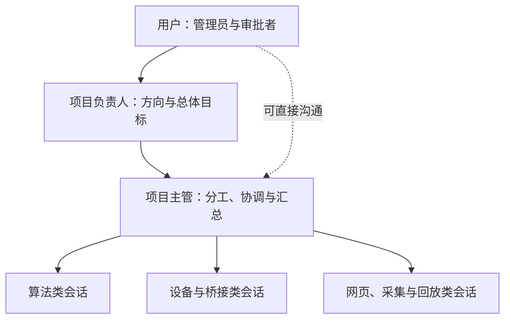

# cweb 团队模式调研与方案草案

调研日期：2026-11-17。代码基线：`ab8ce3c`；本机 Codex CLI：`0.169.0`。状态：供讨论，尚未实现或启用团队通信。

建议为每个工作区增加可关闭的团队模式：把现有的独立会话登记为团队成员，用组织关系说明职责，用通信规则限制联系范围，再由用户批准具体任务和反馈的投递。会话继续使用原来的 Codex thread ID、历史、模型和权限，用户仍能逐个打开和交谈。

产品形态建议是中央区域的「对话／团队」切换，以及右侧栏的轻量团队入口。关系图使用 React Flow；执行继续走 cweb 的 Codex app-server 桥接。现有产品提供了很好的参考，但它们各自的运行时、身份和审批模型不能直接视为 cweb 已有会话的能力。

## 开始前的备份

- Git 工作区在备份时干净，基线为 `ab8ce3c99d37de5e31e0b348db33df8d1cffbf8e`。
- 标签：`backup/2026-11-17-143227-before-team-mode`。
- 独立备份包：`.cache/git-backups/cweb-2026-11-17-143227-before-team-mode.bundle`，4,642,135 字节。
- `git bundle verify` 通过；同名 JSON 保存 SHA-256 和基线信息。
- 这是源码与 Git 历史备份。原生会话、附件、认证和运行数据不在 Git 内，继续按私人迁移包流程备份。

## 现有模式与可借鉴内容

以下对适配成本的判断，是结合官方资料与 cweb 源码作出的设计判断；本轮未安装或运行这些产品。

| 产品或模式 | 已有能力 | 对 cweb 的价值与边界 |
| --- | --- | --- |
| [Claude Code 跨会话通信](https://code.claude.com/docs/en/cross-session-messaging) | 独立会话可互发消息；收件方有接收、暂存和拒绝规则，保留各自权限 | 最接近「原话题增加通信能力」。借鉴发件人标识、收件箱、忙闲处理与审批；cweb 的默认规则应是每条任务正文都由用户批准 |
| [Claude Code Agent Teams](https://code.claude.com/docs/en/agent-teams) | 领队、独立上下文、共享任务与成员通信；文档仍标为实验功能 | 借鉴协作方式。它主要负责创建和协调队友，不能直接用来接管现有 Codex 话题 |
| [Paperclip 组织结构](https://docs.paperclip.ing/guides/org/org-structure/) | 单直属主管的组织树、角色、任务分发和上报、可浏览的组织图 | 最接近「负责人→主管→执行者」。借鉴层级、任务总览与异常上报；其组织和适配器运行体系需要额外部署，首版不整体引入 |
| [MCP Agent Mail](https://github.com/Dicklesworthstone/mcp_agent_mail) | 独立 agent 的身份、收发件箱、消息串、可检索记录、文件占用声明 | 很贴近减少人工传话的需求。旧 Python 仓库已标注不再维护，指向 Rust 版 |
| [MCP Agent Mail Rust](https://github.com/Dicklesworthstone/mcp_agent_mail_rust) | MCP 接入、持久邮箱、网页监督界面、文件预约 | 可研究其产品概念；[当前许可](https://github.com/Dicklesworthstone/mcp_agent_mail_rust/blob/main/LICENSE)标为 MIT 加附加限制，不能当作普通 MIT 组件直接收进本项目。本方案不复制其代码 |
| [OpenClaw 会话工具](https://docs.openclaw.ai/concepts/session-tool) | 列出会话、定向发送、等待回复和子任务工具；另有[可达范围配置](https://docs.openclaw.ai/gateway/config-tools/sessions-and-subagents) | 借鉴明确目标会话、可见范围和通信权限。其默认范围与本项目逐次审批要求不同，需独立定义规则 |
| [CrewAI 层级流程](https://docs.crewai.com/en/concepts/processes) | 主管按能力分配任务并评估结果 | 借鉴职责与验收链；引入其完整执行框架会增加另一套 agent 生命周期，现阶段不需要 |
| [LangGraph 人工中断](https://docs.langchain.com/oss/javascript/langgraph/interrupts) | 保存检查点，等待外部输入，恢复执行；恢复时需要考虑重复副作用 | 借鉴持久审批与恢复机制。cweb 可以用确定性的服务逻辑实现这部分，无需再引入模型编排框架 |
| [Flowise 人工审批](https://docs.flowiseai.com/tutorials/human-in-the-loop) | 可视化流程中的 Human Input 节点，以及工具执行前审批 | 借鉴审批卡和任务流程。流程节点不天然等于持有多年历史的 Codex 会话，不能直接替换 |
| [Vibe Kanban](https://github.com/BloopAI/vibe-kanban/blob/main/README.md) | 任务看板、编码 agent 工作区、差异审查 | 可参考任务与会话的联动。当前 README 已标注正在收尾，首版不作为核心依赖 |
| [A2A 协议](https://a2a-protocol.org/latest/topics/key-concepts/) | Agent Card、消息、任务与产物等跨系统通信概念 | 适合作为未来对接其他 agent 产品的适配层；单机同工作区首版无需部署一套 A2A 服务，协议本身也不替代用户审批 |
| [Codex app-server](https://learn.chatgpt.com/docs/app-server) | 原生会话继续、轮次启动、流式事件、审批与工具接入 | 保留为执行基础。团队角色、通信审批和跨话题任务生命周期由 cweb 补充 |

### 关系图组件

| 组件 | 特点 | 建议 |
| --- | --- | --- |
| [React Flow](https://reactflow.dev/) | React 节点与连线、拖拽、缩放、选择和自定义卡片；[包元数据](https://github.com/xyflow/xyflow/blob/main/packages/react/package.json)为 MIT，当前声明支持 React 18 及以上 | 首选；能沿用 cweb 的 React 卡片、图标、字号和主题。实施时锁定实际兼容版本，付费示例另行核对 |
| [AntV X6](https://github.com/antvis/X6) | HTML/SVG 图编辑引擎，有连线和编辑扩展 | 如果以后发展成复杂流程编辑器，可再评估；首版没有必要同时引入两个图引擎 |
| [Cytoscape.js](https://js.cytoscape.org/) | 网络图展示、布局及图算法，核心与官方扩展为 MIT | 更适合大量关系的分析视图；目前十几个成员的交互卡片优先采用 React Flow |

普通树形侧栏直接复用列表组件。完整图引擎只在打开团队关系页时加载。性能设计参考 [React Flow 的局部订阅与 memoization 建议](https://reactflow.dev/learn/advanced-use/performance)。

## 团队成员与关系

### 现有会话原样加入

工作区中有 16 个会话，不意味着启用时同时唤醒 16 个模型。启用模式只保存配置，用户勾选现有会话作为成员；以后仍可加入、移出和更换职责。

成员绑定工作区 ID 和原生 thread ID，标题只是展示名。重命名不会丢关系，归档、删除或工作区变化会让对应关系停用并提示用户。移出团队只移除通信资格，保留会话历史和任务审计记录。

以用户提供的结构为例：

图中第三层为分组示意；实际各会话都是独立成员卡片。用户可以直接打开任何一层，三层也只是初始模板，不硬编码为最大深度。

### 三种关系分开存储

| 关系 | 说明 | 约束 |
| --- | --- | --- |
| 管理关系 | 谁分配职责，遇到问题向谁汇报 | 初版采用一个直属主管；禁止自环和祖先回环；职责变化由用户管理 |
| 通信关系 | 谁可以向谁提交任务、求助或结果 | 有方向、有消息类型；默认只提供上下级通道；横向协作由用户连线开启；每条正文仍需审批 |
| 任务依赖 | 某任务在另一任务产物可用后才能开始 | 单独保存为无环依赖关系，避免两个成员互相等待；不能从组织连线直接推导 |

拖动卡片只改变图的位置。创建管理边或通信边，需要明确选择关系类型并确认。连上线表示允许提出请求，不表示提前批准以后所有内容。

## 消息审批与投递

### 一次任务如何流转

1. 主管通过团队工具提出任务，填写收件会话、目标、交付物及必要引用。
2. cweb 保存待审批消息并立即返回请求 ID。发送方可以继续其他工作，或结束本轮等待；不占着一个工具调用空等用户。
3. 用户在审批箱查看完整正文，选择「允许本次」「修改后允许」「拒绝」或「稍后」。
4. 批准绑定收件人、正文、附件版本和请求版本。改正文或改目标后，旧批准失效；批量批准也只针对已选中的具体版本。
5. 接收方空闲且可由 cweb 安全驱动时，投递到原会话；正在工作、压缩、等问答或由其他终端占用时，进入等待队列。
6. 接收方完成后提交结果。结果正文同样经过审批，再送回主管；主管按需要继续提出任务或向上汇总。

批准投递会允许接收会话在可运行时开始处理，因此卡片需明确显示「将启动一轮」或「将排到当前任务之后」。人手发送的普通聊天继续走原有入口。

### 审批卡必须显示的信息

- 发件人与收件人的会话名称、角色及所在工作区。
- 任务标题、完整要求、需要接收方做什么以及预期交付物。
- 必要上下文片段、引用文件和产物；大附件按需打开，避免默认读完整历史。
- 关联任务、父任务、原请求和已有回复，便于看出这是不是新要求。
- 接收方当前状态，以及批准后会马上执行还是排队。
- 修改后允许时，记录用户改动，并让接收方看到这是管理员调整过的内容。

「已送达」「已接收」「进行中」「产物待验收」分开显示。网络送达不代表对方已经理解或完成，模型说完成也不等于用户验收。

任务、求助、补充说明和成果反馈的模型正文全部走同一道审批门。系统生成的投递回执与忙闲状态仅更新界面，不唤醒模型，也不为机械回执反复弹审批。拒绝理由属于用户本次决定，可让发件方查询；需要重新唤醒发件方修改时由用户选择。

初版不提供永久自动批准。后续若审批过多，可以讨论限定任务、限定成员、限定次数的授权；不能把一次通过默认为长期授权。

### 可恢复的状态

消息使用独立状态：待审批、已拒绝、待投递、等待接收方、投递中、已送达、需核对、已取消、已过期。

任务另有：待分配、待接受、执行中、受阻、成果待审、已验收、已取消。任务与消息关联，避免把「信已发出」误画成「任务已完成」。

- 用户关闭网页，待审批内容保留；已批准任务可以由后台继续投递。
- 连接断开时保留任务；恢复后先查询原生队列、消息 ID 和回执，再决定是否重试。
- 请求可能已经到达 Codex 但响应丢失时显示「需核对」，不换一个 ID 直接重发。
- 不承诺网络条件下无条件的恰好一次执行；采用固定 ID、原子状态转换和结果核对降低重复执行风险。
- 关闭团队模式暂停新请求和未投递队列，保留记录；已经开始的原生轮次仍由用户单独停止。暂停队列与停止模型任务是两个明确动作。
- 用户自己发给某会话的消息优先，团队任务不得自动抢占或打断它。
- 审批过久、职责改变、引用文件变化或会话编辑回退后，待发任务需要重新校验；必要时回到待审批。

## 页面与操作设计

### 入口

工作区菜单提供「启用团队模式」。开启后，在该工作区顶部出现「对话／团队」切换；其他工作区保持各自设置。

右侧栏保持「待办」第一位，新增「团队」入口，展示当前会话的主管、可联系成员、收件箱与待审批数量。点「展开团队总览」进入中央区域。

### 团队总览

提供四个视图：

| 视图 | 用户可做的事 |
| --- | --- |
| 关系图 | 自动整理层级、拖动位置、添加或撤销连线、按角色折叠、搜索成员；选中节点查看详情或进入原会话 |
| 任务 | 按主管、负责人、依赖和状态浏览任务；点击产物直接预览文件或跳到原回答 |
| 审批 | 集中处理本工作区全部通信；可逐条或选择具体请求批量审批，不必来回切换会话 |
| 动态 | 查看谁提出了什么、谁批准、投递到哪一轮、何时反馈以及为何失败；支持按任务追溯 |

成员卡片只显示会话名、职责、当前任务摘要、忙闲状态和待处理计数。选中后再加载详细内容。边上的待审或待投递计数可以打开消息串，空闲连线不持续发光或运动。

同一套信息在窄屏切为树形列表与详情抽屉。图支持适配视口、缩放和重置；连线操作也提供表单入口，便于键盘和触摸使用。手动布局保留，实时事件只更新状态，不把卡片重新排队。

### 与现有待办和通知的关系

团队任务保留唯一 task ID；接收方待办只显示它的关联项，不复制为两套独立完成状态。成员提交成果进入主管审核和用户验收路径；任何 agent 都不能代替用户勾选最终通过。

跨会话待审消息使用现有未读提醒和右下角通知；集中显示工作区审批数量，避免每次系统回执都弹窗。点击后定位具体请求。

## cweb 接入方式

以下是本轮源码和本机 schema 的静态核对，不是团队功能已经跑通。

| 当前代码 | 可以复用 | 必须补充 |
| --- | --- | --- |
| [`session-router.ts`](../../bridge/server/session-router.ts) | 根据 thread ID 找到原生引擎，隔离不同来源连接故障 | 团队成员需绑定稳定身份和工作区；不能因为标题相同就换目标 |
| [`bridge.ts`](../../bridge/server/bridge.ts) | 原会话继续、`turn/start`、`turn/steer`、运行中和外部占用检查 | 专门的团队投递路径；默认不使用 steer 打断工作；继承收件会话的配置 |
| [`submissions.ts`](../../bridge/server/submissions.ts) | 提交 ID、正文指纹和未知结果核对 | 团队消息版本、批准记录、任务关系、持久待发队列；保留明确的未知结果状态 |
| [`todo-note.ts`](../../bridge/server/todo-note.ts) 与 [会话 MCP 适配器](../../bridge/plugins/todo-note/mcp.mjs) | 工具入口和旧会话接入思路 | 团队专用工具及身份验证；不能原样复用可获取网页控制令牌的便签适配方式作为严格审批隔离 |
| [`App.tsx`](../../bridge/client/App.tsx)、[`Inspector.tsx`](../../bridge/client/Inspector.tsx) | 右侧栏、会话状态、轻量缓存和通知体系 | 懒加载的团队页面、集中审批视图和局部状态订阅 |
| [`http.ts`](../../bridge/server/http.ts) | 同源校验、服务端接口与 SSE | 团队权限边界、请求版本校验、审核写入和事件游标 |

### 拟增加的工具

| 工具草案 | 能力 |
| --- | --- |
| `team_members` | 查看当前会话可联系的成员及职责 |
| `team_propose_message` | 提交任务、问题或协作请求，返回待审批 ID；不直接投递 |
| `team_inbox` | 读取已授权给当前成员的消息和自己请求的状态 |
| `team_report_task` | 更新分配给自己的任务进展，提交待审批的结果或阻塞说明 |

发件身份由宿主绑定，工具参数不接受任意 sender ID。工具不能批准自己的请求、改变团队连线或授予新权限。接收方显示可靠来源标签，不能把其他 agent 的正文升级成系统指令或伪装成人工输入。

新旧会话均需核对工具是否实际可用。当前代码对已载入的旧会话不会假定 resume 配置立即生效；沿用这一原则，必要时等空闲后重新接入，并在卡片上显示接入状态。不能声称用户一开模式，所有正在运行的原生 CLI 就立即获得工具。

### 原生队列与会话所有权

本机 `0.169.0` 的导出协议包含 `thread/queue/add/list/start` 等实验接口，`queue/add` 有 `clientUserMessageId`。现有 cweb 仍使用进程内消息队列；相关结论也记录在 [能力对照](codex-0.169-capability-map.md)。

优先验证原生队列的持久性、去重、启动条件和多客户端行为，兼容后再决定是否采用。团队审批账本无论如何都由 cweb 持久保存。每条获批消息只能选择一种投递执行器，不能让本地队列与原生队列同时启动它。

普通 CLI 正在独立驱动同一会话时，团队请求先等待，不能通过第二个进程强行继续。可共享的 daemon、独立终端和 cweb 自管 stdio 都需分别验证；无法可靠驱动时明确显示「等待原终端释放／接入」，并提供打开原会话入口。

## 数据、上下文与权限

建议在 cweb 私有数据目录中增加团队数据库，使用事务保存成员、关系、任务、消息、审批、投递回执和事件。可以优先评估 Node 内建 SQLite；原生 Codex 数据库仍只通过原生接口操作，团队模块不直接改它。

待审批正文不能出现在接收方模型可读的收件箱、上下文快照或自动打开的会话记录中。只有服务器通过审批校验后才能进入投递通路。模型工具与浏览器审批接口应使用不同能力凭据，不能给 agent 一个能批准请求的网页管理令牌。

同一用户下拥有完全文件和进程权限的 CLI 并不是强隔离环境。这套审批首先约束 cweb 的通信通路；若要防止任意本地高权限进程绕过系统，就必须增加进程、账户或沙箱隔离，不能仅靠提示词声称做到。

每个成员保留自己的上下文。默认只共享经审批的任务、必要摘要和产物引用；不把 16 个会话历史合并，不自动共享每张图片。公共项目说明可以作为明确版本的资料供成员按需读取。审批引用需绑定摘要或版本，避免用户看过后文件又被替换。

成员权限继续取自接收会话，角色高低不改变沙箱、命令审批或设备操作权限。批准传达一个任务不自动授予原先没有的能力。

多个会话共用项目文件时，先用任务范围、目录责任和文件占用声明提示冲突；这是协调约定，不是文件系统锁。代码隔离需求明确时再选择 Git worktree，硬件项目不自动切换工作树、启动设备或撤销运行中的修改。

新团队数据必须加入已有私人迁移包的快照和恢复流程；使用工作区 ID、thread ID 和相对引用，移植时重新绑定物理路径。凭据不放进公开仓库；可导出不含聊天正文的关系模板。

## 性能与稳定性要求

- 关闭团队模式时，不加载图引擎，不扫描各成员全文历史，不启动团队轮询。
- 总览只读取成员摘要与计数；打开成员详情、任务记录或附件时再分页读取。
- 复用 SSE 连接并增加团队事件，断线后用游标和版本补齐；只更新发生变化的卡片。
- 拖拽过程保存在局部状态，拖拽结束再保存；事件更新不重新自动布局。
- 隐藏页面停止图动画，静态边默认不动画；按需折叠下属分组，使用已有字号与减少动态效果设置。
- 空闲成员不因心跳、读未读数或机械回执消耗模型轮次。只有已批准的具体投递会触发模型。
- 同一会话串行处理任务；工作区可设团队派发并发上限，并让用户主动消息优先。
- 为每个任务记录回复链和任务版本，限制排队长度及重复请求，防止 agent 互相回复形成无限循环。
- 状态更新不能宣称解决 Provider 断网；网络问题应显示原因、保留队列并有界重试，不自动重复执行已发生副作用的任务。

实施验收用 16、50、100 成员夹具，比较开启前后的首次加载、输入响应、切换耗时、内存和 SSE 流量。团队关闭时图模块应零下载、团队额外请求为零；其他性能指标先测本机基线再定预算，不承诺未经测量的速度提升。

## 分阶段尝试

| 阶段 | 交付 | 验收重点 |
| --- | --- | --- |
| 1 三会话通信闭环 | 在隔离演示工作区选三个会话，完成提出请求、用户审核、定向投递、反馈再审核；包含持久记录 | 拒绝后接收方没有正文；重复点击和重启不重复派发；忙碌会话不被打断；原会话可继续独立聊天 |
| 2 团队总览 | 工作区开关、关系图编辑、角色树、集中审批、任务与动态视图 | 手工连线规则正确；16 成员图可读；字号、窄屏、键盘、原待办与通知均正常 |
| 3 项目协作完善 | 任务依赖、成果回链、冲突提示、原生终端协作及迁移恢复 | CLI 占用、长时间离线、服务重启、成员归档、消息回退及迁移后身份不混乱 |

第一阶段只验证通信与任务机制，使用文档检查等无硬件动作的任务。通过后再由用户把实际项目成员加入。先打通可信投递，再扩大可视化和分工范围，避免做出好看的关系图却仍需人工复制消息。

### 必须覆盖的异常验收

1. 未授权目标、跨工作区目标、伪造发件人、agent 自批请求均不能通过服务校验。
2. 两个浏览器同时处理同一请求，只有一次有效决定；修改后的内容不能沿用旧批准。
3. 在投递前、Codex 已收到但回执丢失、结果回传前三种位置断线，均能恢复到可解释状态。
4. 接收方在忙、等待命令批准、等待问答、压缩上下文、终端占用和已归档时分别处理。
5. 用户中途聊天、编辑回退、改变职责或关闭团队，旧任务不会悄悄恢复执行。
6. 团队记录与现有待办、会话历史均能随私人迁移包恢复，且不会进入公开 Git。

## 需要讨论的产品取舍

推荐默认：工作区逐个开启、每条正文审批、中央团队总览加右侧快捷入口、原会话空闲后投递、保留所有独立聊天能力。

调研后用户选择先验证三会话审批闭环，并要求新建隔离工作区。该阶段的启动方式、验证结果与边界见[团队通信试验](../team-pilot.md)；真实工作区接入与可拖拽关系图仍待后续讨论。
